# Camera Path Storyboard

The complete camera journey for [CREATIVE_DIRECTION_RESET.md](CREATIVE_DIRECTION_RESET.md). **Proposal only.** Updated 2026-11-05 for the hybrid of manga ink and 1990s painted anime: every frame now states its **language**.

**About the frames.** F02 is your real V6 ink render, with only the proposed Red Line and a text plate added. **Every other frame is my composition sketch**, made in code to judge framing, values and rhythm. They show where the blacks go and how each shot is built. They are not the art quality to expect, and they don't test the real-time renderer. **They are still drawn in ink, so read the Language row for what each frame would really look like.** For real rendering in all three languages, see the [gate proof](reset/gate-proof/README.md).

**Reading each entry:**

- **Position** is in metres on V7's origin (x east, y north, z up). W1 and W2 are V7's real camera path; the rest are proposed.
- **Lens** is on a 36 mm sensor, as in V7.
- **Notches** are mouse-wheel clicks from the start, out of 388.
- **Darkness** names the type from the research (`atmosphere_and_lighting.md`), because "make it darker" is too vague to direct.
- Pale rectangles in frames show where a real HTML text plate would sit. Their contents are blocked in because the type system isn't decided yet.

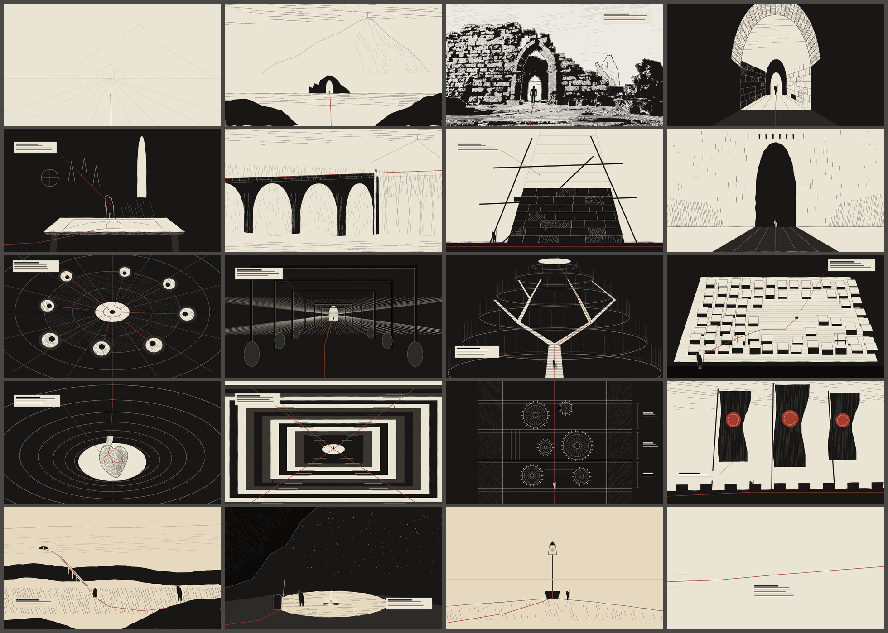

| | |
|---|---|
| 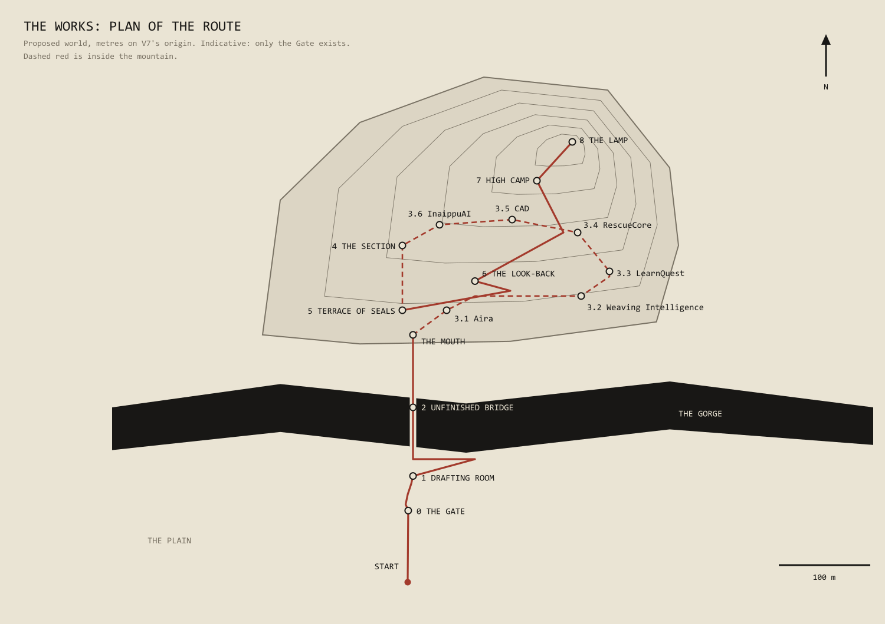 | 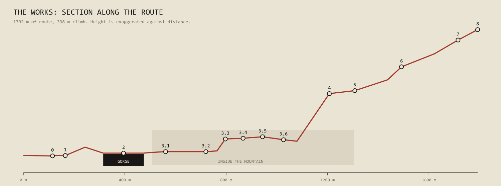 |

Regenerate everything with `node planning/reset/_src/route.mjs`, `frames.mjs`, `map.mjs` and `language-score.mjs`.

## The language score

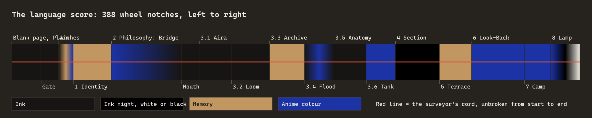

The route moves between **ink**, **memory**, **anime colour** and **ink night**. See section 1 of the reset document for why. It has three colour openings: the first awakening at the gate, the Stepped Tank, and the Look-Back as the climax.

---

## Chapter 0: The Beginning

### F00 The blank page

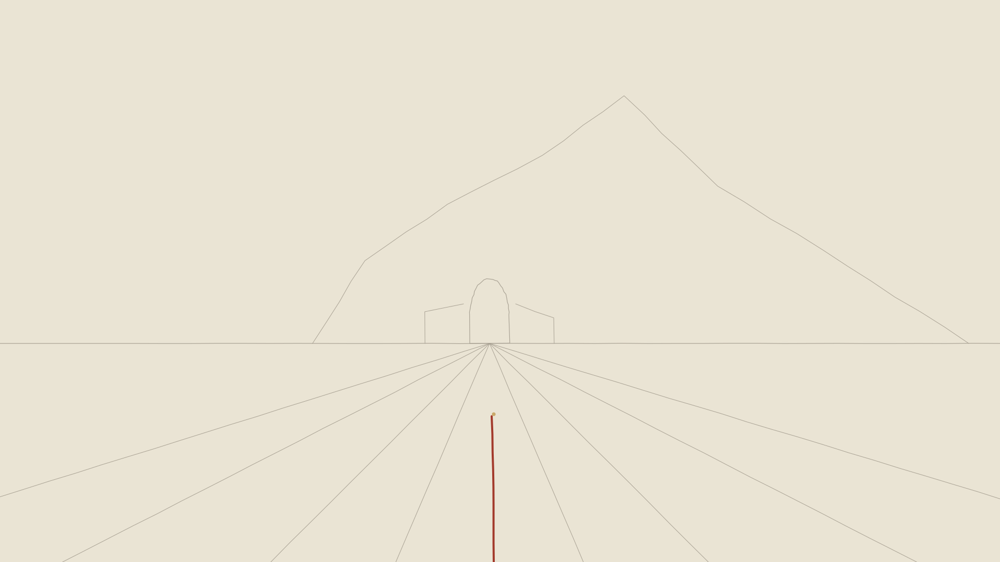

| | |
|---|---|
| **Language** | **Ink.** Pencil on bare parchment. No colour exists yet |
| **Position** | W0 (−6, −120, 1.8), facing north, slight tilt up |
| **Lens** | 24 mm |
| **Notches** | 0–6 |
| **Move** | None at first. A very slow push once you begin |
| **Darkness** | None. An empty page |
| **What happens** | While assets load, this is the loading screen: parchment, pencil guidelines, the first inch of Red Line. A stroke at a time, the plain begins to exist |
| **Transition out** | Ink front spreads from the near ground into the distance |

### F01 The plain

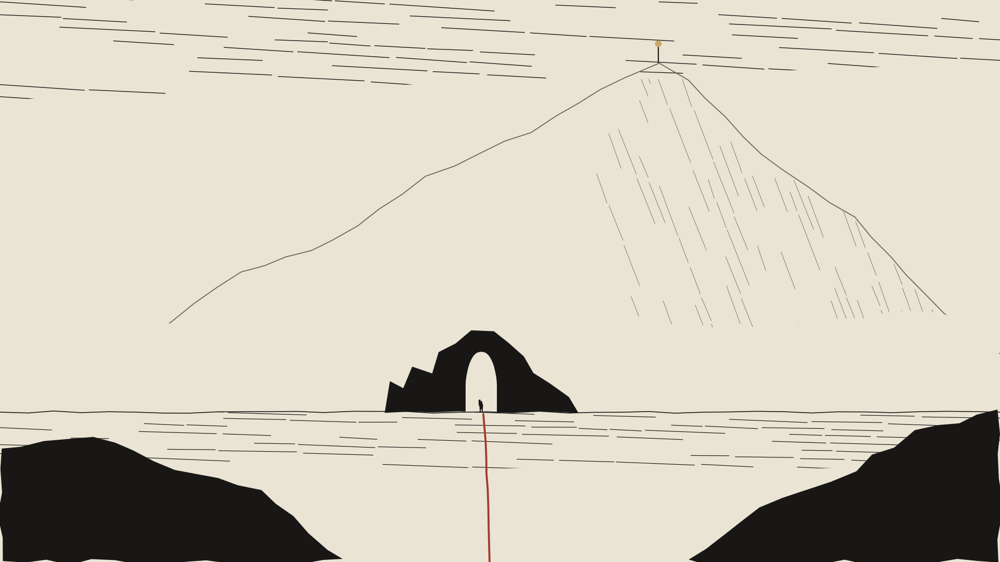

| | |
|---|---|
| **Language** | **Ink.** The Lamp's gold and the Red Line are the only colour |
| **Position** | W0 → W1 (−5.4, −9.4, 0.32), 111 m |
| **Lens** | 24 mm easing to 22 mm |
| **Notches** | 6–20 |
| **Move** | Long, steady, low push. Camera sinks from 1.8 m to 0.32 m |
| **Darkness** | Black foreground masses framing a pale plain |
| **Direction** | The most important orientation shot in the film. **The whole journey is visible:** Red Line, gate, mountain, one gold point at the top. No words are needed |
| **Transition out** | Gate grows until it fills the frame |

### F02 The Gate (real render)

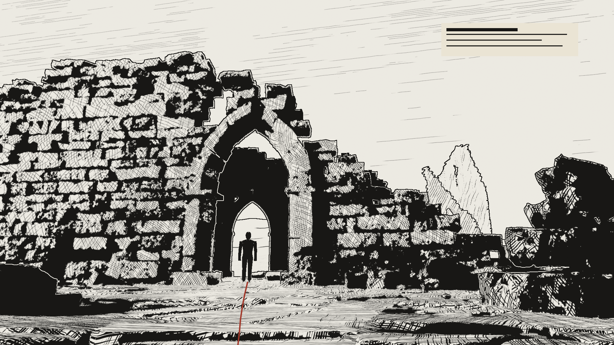

| | |
|---|---|
| **Language** | **Ink, the moment before it wakes.** **Real, live frames exist:** [ink](reset/gate-proof/captures/01-ink.png), [memory](reset/gate-proof/captures/02-memory-sepia.png), [anime](reset/gate-proof/captures/03-anime-colour.png), [ink night](reset/gate-proof/captures/04-ink-night.png) |
| **Position** | W1 → W2 (−6.55, −5.3, 0.55): V7's real 4.26 m move |
| **Lens** | 22 mm, tilted up about 15–19° |
| **Notches** | 20–32, a dwell |
| **Move** | V7's slow push, unchanged |
| **Darkness** | Black architecture against a paper sky |
| **Text** | The title, on its spine, and the supporting line, on the calm sky |
| **Transition out** | Red Line pulls the eye to the arch |

## Through to Chapter 1

### F03 Through the arch

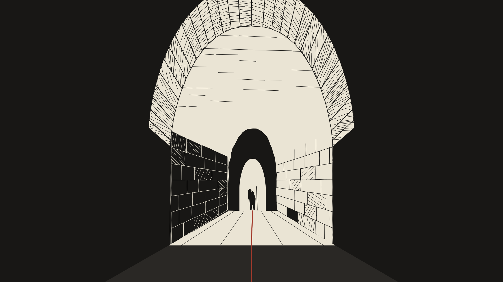

| | |
|---|---|
| **Language** | **Ink → Memory → Anime.** **The first awakening, the signature moment.** The front runs out from the Red Line: strokes lift, wash soaks in, paint arrives, flecks rise and become stars. [See it in steps](reset/gate-proof/captures/08-walking-through-the-gate.png) |
| **Position** | W3 (−8.3, 0, 1.4) → W4 (−6, 15.5, 1.5), 21 m in all from the end of F02. **Correction from the proof:** the inner gate is really at about (−12.1, 15). The live route uses that, and W4 needs moving at the blockout gate, which will change the route totals slightly |
| **Lens** | 20 mm |
| **Notches** | 32–42 |
| **Move** | Through the hero arch; the passage bends about 15° as V3 designed it; the inner gate frames the Wanderer, who walks on |
| **Darkness** | Silhouette against light |
| **Transition out** | Inner gate passes the lens. A moment of solid black |

## Chapter 1: Identity

### F04 The Drafting Room

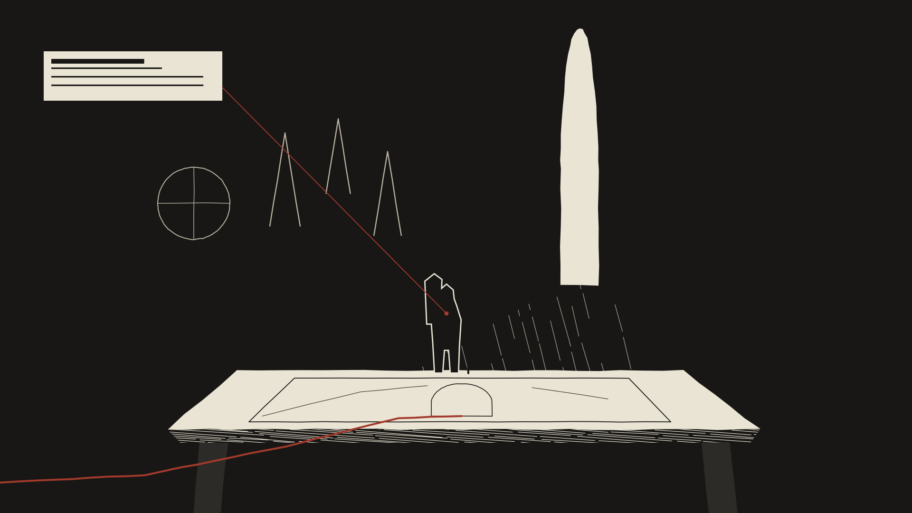

| | |
|---|---|
| **Language** | **Memory.** Colour settles to amber. One warm table in a dark room |
| **Position** | W5 (−2, 32, 1.6) → W6 (0, 44, 1.5) |
| **Lens** | 28 mm |
| **Notches** | 42–68, mostly dwell |
| **Move** | In from the door, then a 1.5 m sideways drift while you read |
| **Darkness** | Single-source interior: one slit of daylight |
| **What it shows** | The brightest shape in the frame is a sheet of paper. The Wanderer works at it with his back to us. The Red Line climbs onto the table and becomes a drawing. Instruments hang in silhouette |
| **Text** | Name, study, institute, graduation, GitHub, interests |
| **Transition out** | The camera turns to a breach in the north wall; white light floods the lens |

## Chapter 2: Philosophy

### F05 The Unfinished Bridge

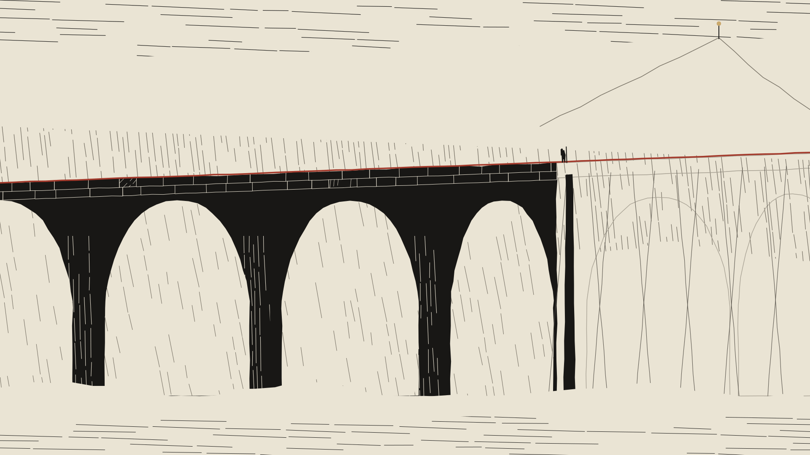

| | |
|---|---|
| **Language** | **Anime fading to ink.** Painted stone at left, turning to ink and then pencil at right. Cobalt sky above the built part |
| **Position** | W6b (70, 70, 24), out over the gorge edge, looking back west along the span. Then down onto the deck at W7 (0, 70, 8) |
| **Lens** | 24 mm |
| **Notches** | 68–84 |
| **Move** | A wide swing out over the void, the first big reveal, then a descent to the deck |
| **Darkness** | Fog bands. Black stone at left, dissolving to pencil at right |
| **What it shows** | Extreme scale: a tiny figure on a colossal bridge. It becomes construction drawing as it goes. **The picture is the philosophy.** Things exist as drawings first |
| **Transition out** | Camera settles at deck height, facing the unfinished end |

### F06 The pier

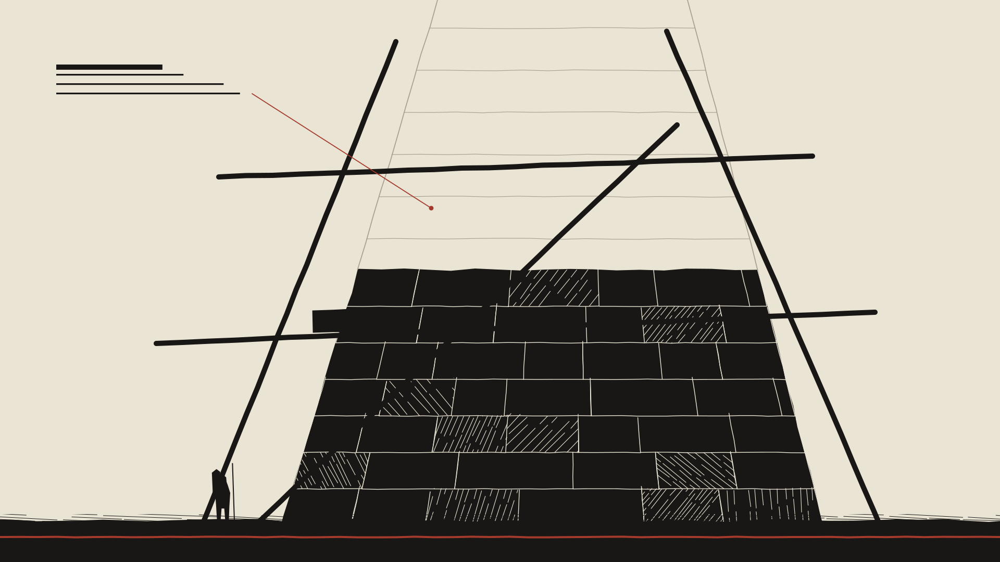

| | |
|---|---|
| **Language** | **Anime at the base, ink above, pencil at the top.** Each pier is literally coming into being |
| **Position** | Deck, around W8 (0, 150, 8), about 0.5 m high, with stops at each of four piers |
| **Lens** | 18 mm, tilted up about 40°, verticals converging |
| **Notches** | 84–116 |
| **Move** | Walk, stop, look up; four times. Stones are inked at the base and pencil at the top |
| **Darkness** | Hatched darkness low down, nothing above |
| **Text** | One principle per pier. **Requires your words.** Until then only your verified working style appears, on one pier |
| **Transition out** | Deck becomes fully pencil, then the mountain's face fills the view |

## Chapter 3: Selected Projects

### F07 The Mouth

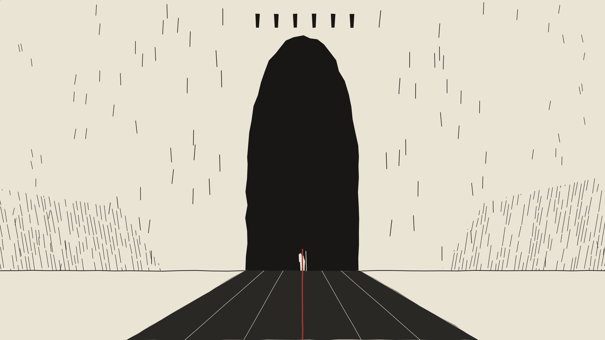

| | |
|---|---|
| **Language** | **Colour absorbed back to ink.** Colour drains into the blacks as you approach. The first deliberate return |
| **Position** | W9 (0, 230, 8) → W10 (0, 262, 10) |
| **Lens** | 28 mm, strictly frontal and level |
| **Notches** | 116–128 |
| **Move** | Slow, formal push. The only perfectly symmetrical approach so far |
| **Darkness** | Solid black stage in a pale cliff |
| **What it shows** | One enormous slit. Six cuts above it: six works |
| **Text** | Small chapter opener, once inside the black |
| **Transition out** | Black gutter |

### F08 Aira: the Watch-House

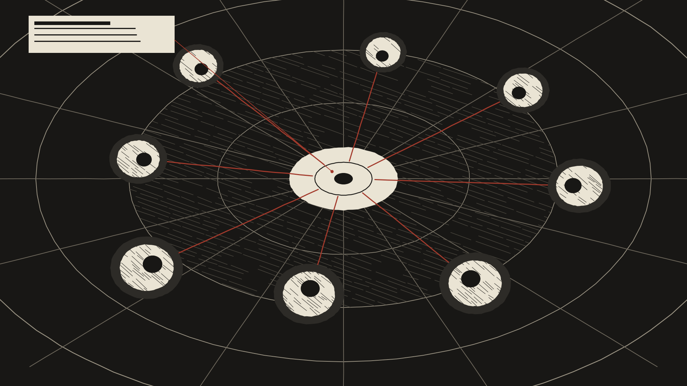

| | |
|---|---|
| **Language** | **Ink, with colour only through the lenses.** Each lens shows a small circle of painted world |
| **Position** | W11 (38, 300, 12), looking almost straight up |
| **Lens** | 16 mm |
| **Notches** | 128–150 |
| **Move** | Tilt up from the floor map to the dome, with a slow 12° roll about the vertical |
| **Darkness** | Black dome, pale central opening |
| **What it shows** | Many lenses, each looking its own way, cabled by Red Line to one drum: agents, vision, memory. The floor below is a map with pins, for spatial memory |
| **Transition out** | The camera drops back down. One cable feeds into a floor duct; follow it. Gutter |

### F09 Weaving Intelligence: the Loom

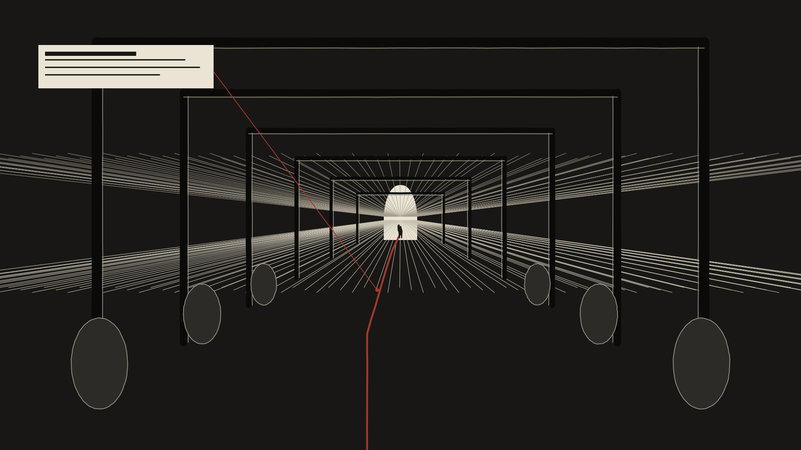

| | |
|---|---|
| **Language** | **Pure ink.** Any other colour would ruin the one red thread |
| **Position** | W12 (70, 322, 12) → W13 (190, 322, 12), 1.6 m high, along the warp |
| **Lens** | 22 mm, exact one-point perspective |
| **Notches** | 150–176 |
| **Move** | **The fastest move in the film.** Heddle frames flicker past, then it brakes hard and stops |
| **Darkness** | Black hall, threads as thousands of fine pale lines |
| **What it shows** | The frames repeat, so size can be counted. Pressure vessels line the walls for compressed air. **One thread is red.** That is the abnormality |
| **Performance note** | Threads are thin lines, which are cheap, but they are prone to shimmer and need testing |
| **Transition out** | The red thread winds onto a bobbin. Follow it up |

### F10 LearnQuest: the Trial Archive

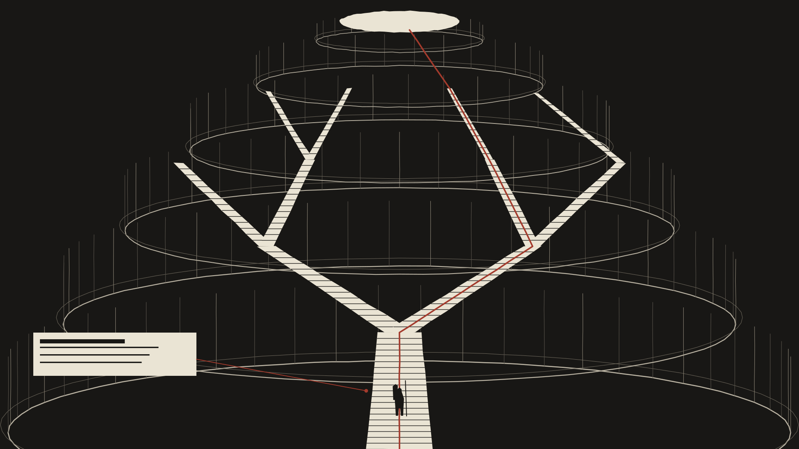

| | |
|---|---|
| **Language** | **Memory.** Aged paper and amber light down from the crown |
| **Position** | W14 (222, 352, 14) → W15 (222, 360, 46), rising 32 m |
| **Lens** | 18 mm, tilted steeply up |
| **Notches** | 176–200 |
| **Move** | Crane up, following one branch of the stair |
| **Darkness** | Tone darkness on the walls, stairs catching light from the crown |
| **What it shows** | Staircases branch like a document tree, because the project evaluates pages by their DOM. Shelves ring every gallery. The Line has become a book's ribbon |
| **Transition out** | The ribbon marks a place on a map |

### F11 RescueCore: the Flood Table

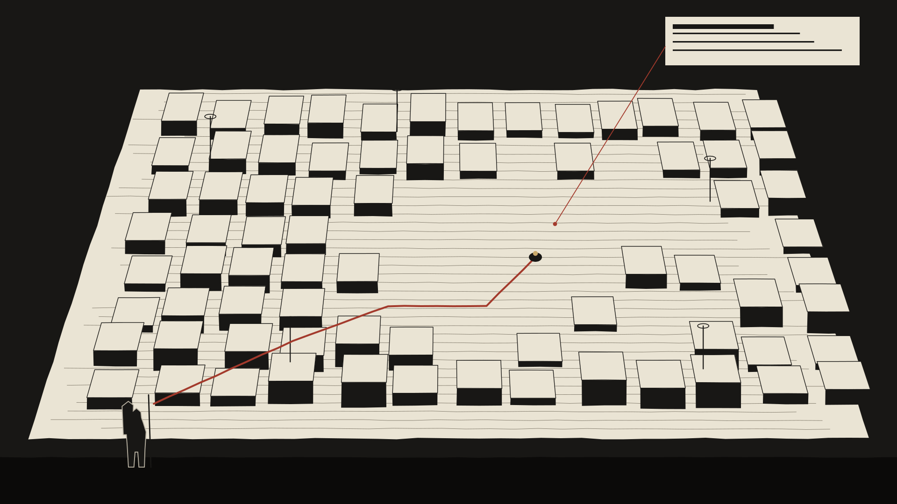

| | |
|---|---|
| **Language** | **Ink room, painted table.** Cobalt water and small warm lights on the model. The room stays black |
| **Position** | W16 (186, 420, 48), on a gallery, tilted down about 50° |
| **Lens** | 28 mm |
| **Notches** | 200–220 |
| **Move** | Dolly along the rail |
| **Darkness** | Black room, one overhead light on the table |
| **What it shows** | A drowned district at model scale. Signal masts. A lantern rover **labelled as a concept**, with the Red Line as its route. No people, no suffering |
| **Transition out** | **Match cut.** Push into the branching flood channels until they fill the frame |

### F12 CAD: the Anatomy Theatre

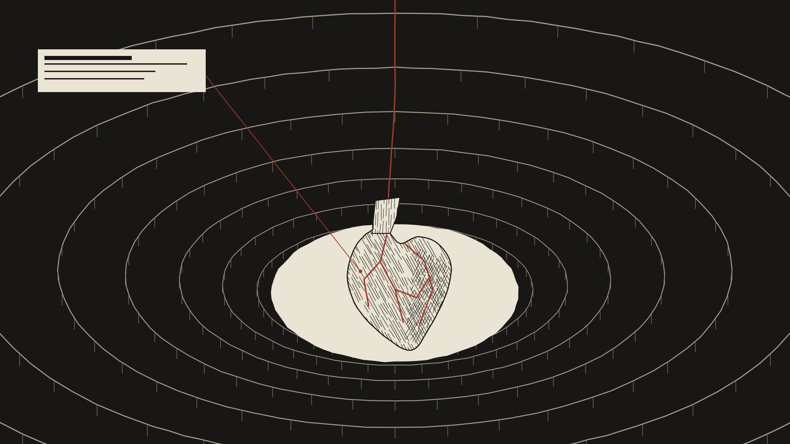

| | |
|---|---|
| **Language** | **Pure ink.** Engraving. Vessels in Red Line only |
| **Position** | W17 (112, 440, 52), rim, descending about 8 m into the tiers |
| **Lens** | 35 mm, tilted down about 35° |
| **Notches** | 220–242 |
| **Move** | Pull back from the channels, which are now vessels, then descend the tiers. **The heart can be rotated by dragging at this stop** |
| **Darkness** | Stacked black tiers around a bright well |
| **What it shows** | Engraved heart with Red Line vessels, the only moment the Line is flesh |
| **Text** | Project facts and medical disclaimer, wording to be confirmed by you |
| **Transition out** | The vessels run on into stone channels |

### F13 InaippuAI: the Stepped Tank

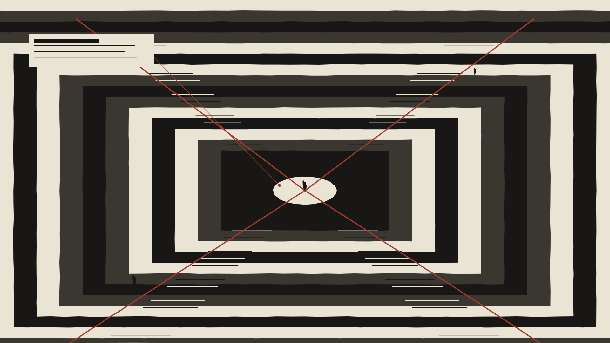

| | |
|---|---|
| **Language** | **Anime.** **The second opening.** Open to the sky, with real stars in cobalt water, after a long dark |
| **Position** | W18 (30, 432, 44), rim, tilted down about 40° |
| **Lens** | 24 mm, symmetrical |
| **Notches** | 242–262 |
| **Move** | Slow crane forward over the steps |
| **Darkness** | Op-art bands of light and shadow; black water, one pale reflection |
| **What it shows** | Flights from four sides lead to one platform. Four red lines arrive and join. Depends on decision 4 |
| **Transition out** | The joined Line rises vertically. Tilt up |

## Chapter 4: Engineering

### F14 The Section

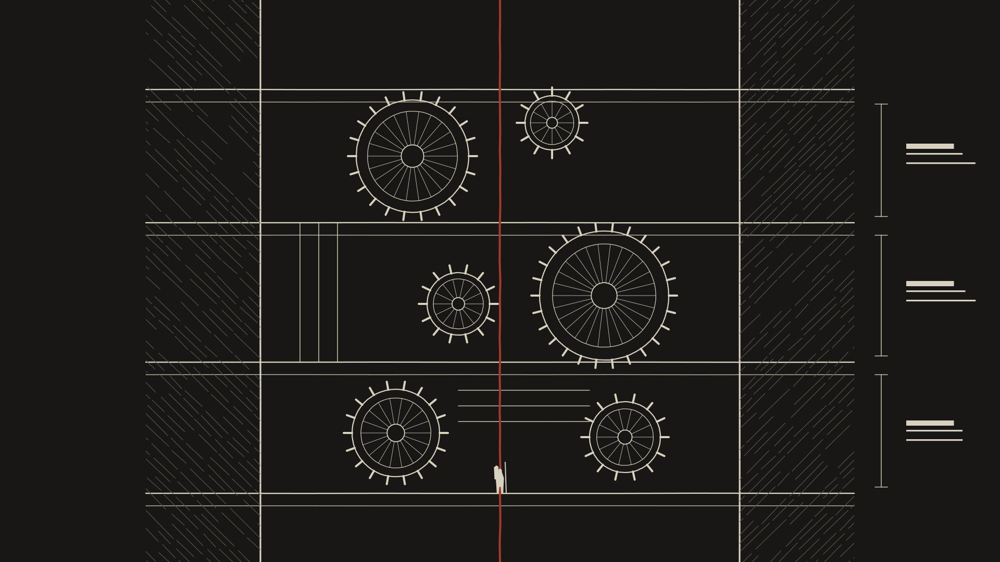

| | |
|---|---|
| **Language** | **Ink night.** White on black. Stars and stipple, carried over from the proof |
| **Position** | W19 (−12, 400, 40) → W20 (−12, 400, 168), rising 128 m |
| **Lens** | 50 mm, level, almost like an elevation drawing |
| **Notches** | 262–292 |
| **Move** | A vertical rise at constant speed. Stops at each domain |
| **Darkness** | **Value inversion: white line on black.** The only time. The mountain has turned into its own drawing |
| **Text** | Stacks from your verified projects, bracketed by domain, as dimension annotations |
| **Transition out** | Daylight burns in from above, and the image returns to black on paper |

## Chapter 5: Recognition

### F15 The Terrace of Seals

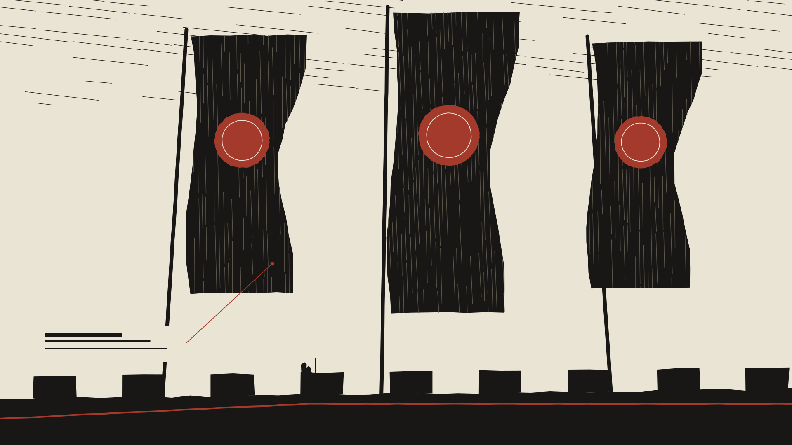

| | |
|---|---|
| **Language** | **Memory.** Burnt-orange sky, with black cloth against it |
| **Position** | W21 (−12, 300, 176), 0.6 m above the terrace, tilted up about 20° |
| **Lens** | 20 mm |
| **Notches** | 292–314 |
| **Move** | Slow drift along the parapet, standard to standard. Cloth moves in the wind, the first moving thing in a long while |
| **Darkness** | Black cloth on open sky. Three oxide seals, the most red anywhere on the route |
| **Text** | The three verified achievements and your IEEE responsibilities. Nothing beyond the wording in your profile |
| **Transition out** | Along the cliff road |

## Chapter 6: Journey

### F16 The Look-Back

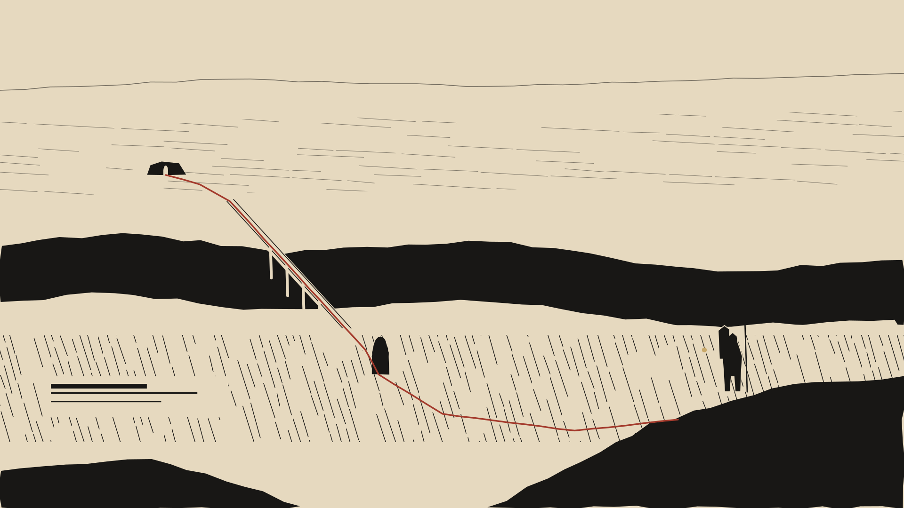

| | |
|---|---|
| **Language** | **Anime, the fullest.** **The climax.** The route lies below, painted because you walked it |
| **Position** | Along the road to W23 (70, 345, 240), then on to W24 (170, 420, 275) |
| **Lens** | 28 mm, tilted down about 25° |
| **Notches** | 314–350 |
| **Move** | **The only time the camera turns to face where it has been:** a slow 180°, then a long hold |
| **Darkness** | Almost none. First sepia in the paper. Black gorge, black ledge |
| **What it shows** | The whole route at once: the gate about 430 m away, bridge, Mouth, Red Line. **The moment that justifies building one real world** |
| **Build requirement** | The Gate, Bridge and Mouth must be visible from here, as far low-detail versions |
| **Text** | Education, and milestones with real dates only |
| **Transition out** | Turns back to the climb |

## Chapter 7: Beyond Code

### F17 High Camp

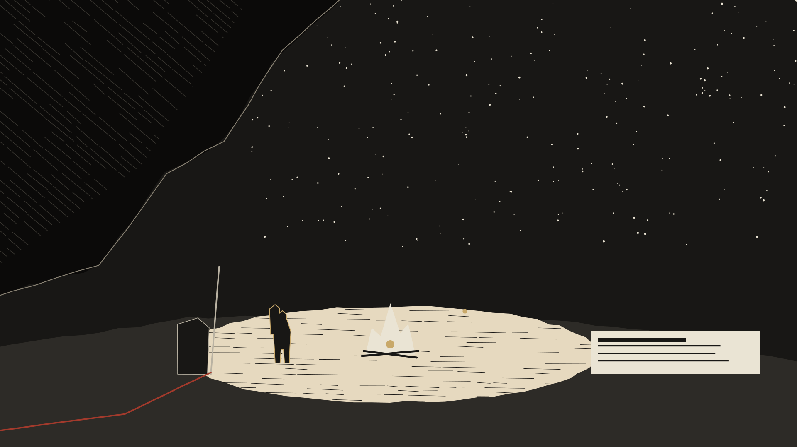

| | |
|---|---|
| **Language** | **Anime night.** Cobalt, stars, one fire. **Avoid the seated back-view under stars, which is one of the references.** Frame it wide or side-on, from across the fire |
| **Position** | W25 (140, 500, 312), 1.2 m high |
| **Lens** | 35 mm |
| **Notches** | 350–368 |
| **Move** | Almost none. A slow drift. Flame and the Spark are the only motion |
| **Darkness** | Black with specks: rock and stars, one fire |
| **What it shows** | The relief scene. **The only time the Wanderer has set his pack down.** Gold rim light on him from the fire |
| **Text** | Whatever you choose to share. It also works wordless |
| **Transition out** | Morning arrives by the paper getting paler |

## Chapter 8: Contact

### F18 The Lamp

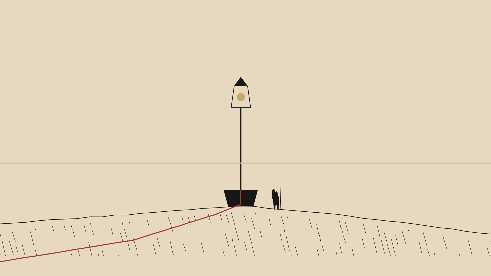

| | |
|---|---|
| **Language** | **Anime draining to ink.** Colour recedes towards a warm line at the horizon |
| **Position** | Approach to W26 (180, 560, 340) |
| **Lens** | 40 mm |
| **Notches** | 368–384 |
| **Move** | A slow walk up the last slope |
| **Darkness** | Almost no ink left. The drawing is thinning out |
| **What it shows** | The Lamp seen from the first frame, finally close. A warm line of sepia at the horizon, as far as colour ever goes |
| **Transition out** | Paper fog rises over the whole frame |

### F19 The page

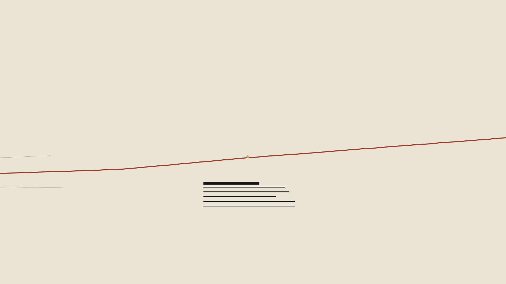

| | |
|---|---|
| **Language** | **Paper.** Only the Red Line and one gold point are left |
| **Position** | Tilting up from W26 into blank sky |
| **Notches** | 384–388, the end |
| **Move** | Comes to rest |
| **Darkness** | None. Bookends F00 |
| **What it shows** | An empty page. The Red Line runs past the edge of the frame: the next section isn't drawn yet, and could be drawn with the visitor |
| **Text** | Contact plate: GitHub today; others when you supply them |

---

## Scroll budget

Computed from the waypoints in `reset/_src/route.mjs` **[M]**.

| Stop | Place | Metres | Travel notches | Dwell notches | Metres per travel notch |
|---|---|---:|---:|---:|---:|
| 0a | Blank page | 0 | 0 | 6 | |
| 0b | Crossing the plain | 111 | 14 | 0 | 7.9 |
| 0c | The Gate | 4 | 0 | 12 | |
| 0d | Through both arches | 21 | 10 | 0 | 2.1 |
| 1 | Drafting Room | 29 | 8 | 18 | 3.6 |
| 2 | Unfinished Bridge | 310 | 24 | 24 | 12.9 |
| 3.0 | The Mouth | 32 | 6 | 6 | 5.3 |
| 3.1 | Watch-House | 54 | 8 | 14 | 6.7 |
| 3.2 | The Loom | 159 | 12 | 14 | 13.2 |
| 3.3 | Trial Archive | 77 | 10 | 14 | 7.7 |
| 3.4 | Flood Table | 70 | 6 | 14 | 11.7 |
| 3.5 | Anatomy Theatre | 77 | 6 | 16 | 12.8 |
| 3.6 | Stepped Tank | 83 | 6 | 14 | 13.8 |
| 4 | The Section | 181 | 14 | 16 | 12.9 |
| 5 | Terrace of Seals | 100 | 6 | 16 | 16.7 |
| 6 | The Look-Back | 314 | 22 | 14 | 14.3 |
| 7 | High Camp | 93 | 6 | 12 | 15.5 |
| 8 | The Lamp | 77 | 8 | 12 | 9.7 |
| | **Total** | **1,792** | **166** | **222** | |

**What to watch for at Gate 2:** 57% of the wheel distance is dwell, which favours reading over travel. Stretches above about 12 m per notch would run past the proposed speed limits if someone scrolls flat out, so they lean on gutters and spring damping. **This table is a starting point, and only real scrolling can settle it.**

## The rhythm of density and rest

From the research: a page feels heavy because of the quiet page next to it. Reading the contact sheet by value:

| Stretch | Value |
|---|---|
| F00–F01 | Nearly empty |
| F02–F04 | **Heavy** |
| F05–F06 | Open, with fog |
| F07 | One black slit in pale stone |
| F08–F14 | **The dense core:** seven dark, packed frames. F11's pale table and F13's bands stop it becoming monotonous, but this is the stretch to watch for fatigue |
| F15–F16 | **The release:** first open air, then the widest shot of all |
| F17 | Dark again, but small and warm |
| F18–F19 | Ink runs out |

## The rhythm of colour

Value rhythm above still applies. Colour needs its own rhythm, or the awakening stops being special:

| Stretch | Colour |
|---|---|
| F00–F02 | None. Establishes that this is a drawing |
| F03 | **First awakening** |
| F04–F06 | Settles to memory, then colour only in what is finished |
| F07–F12 | Colour leaves. The long ink core, with small exceptions at the lenses and the table |
| F13 | **Second opening,** and a relief |
| F14 | Black, the opposite extreme |
| F15 | Memory |
| F16–F17 | **The climax and its quiet** |
| F18–F19 | Everything drains to the page |

**Only real scrolling can settle this.** The proof shows one awakening, and we don't yet know how often it can happen before it stops being special.
