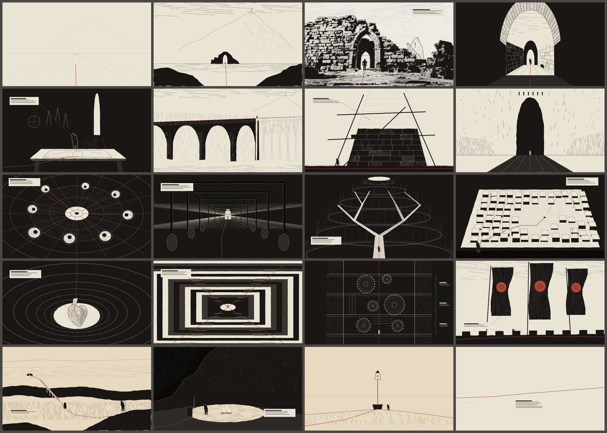
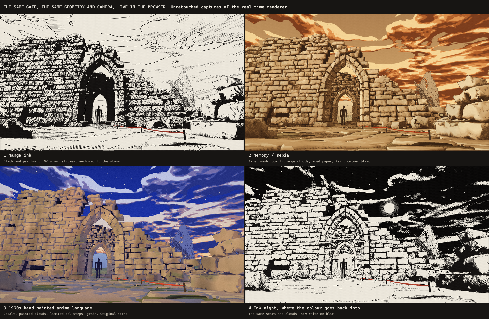
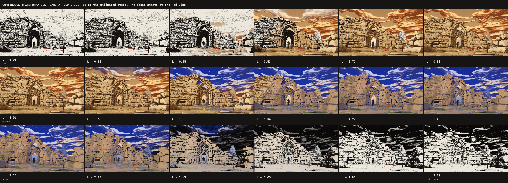
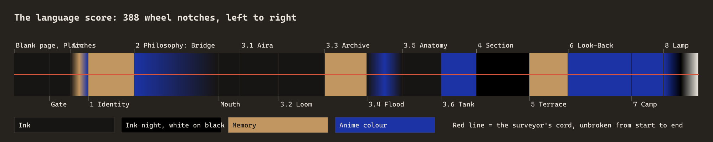
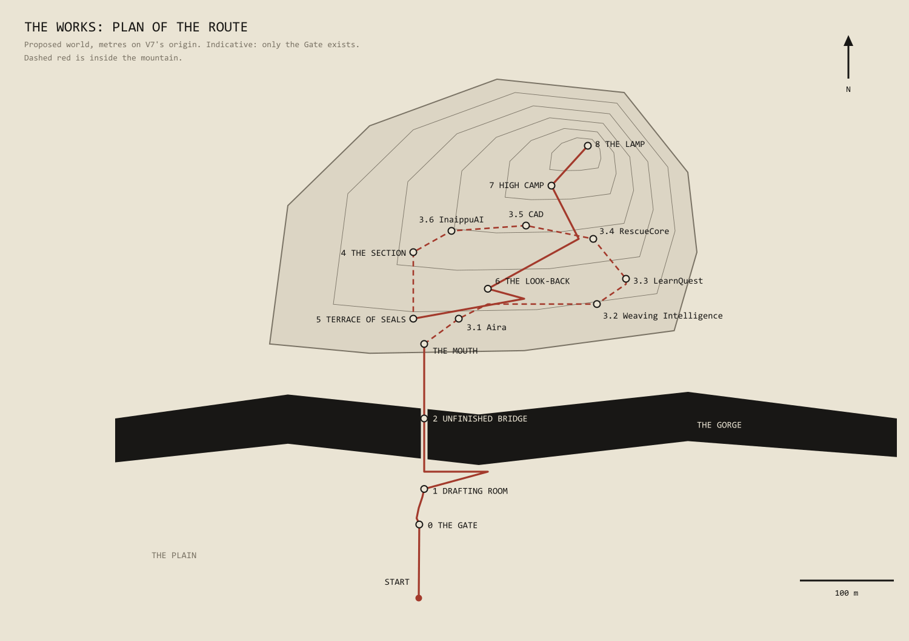
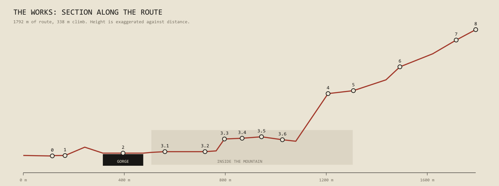
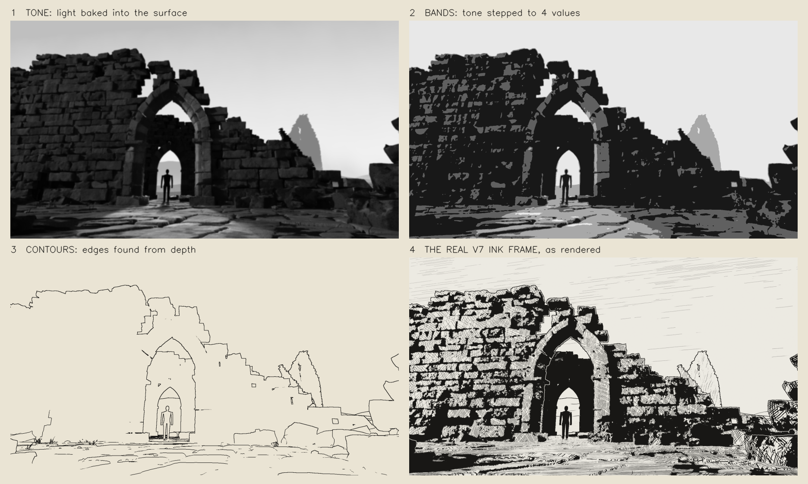
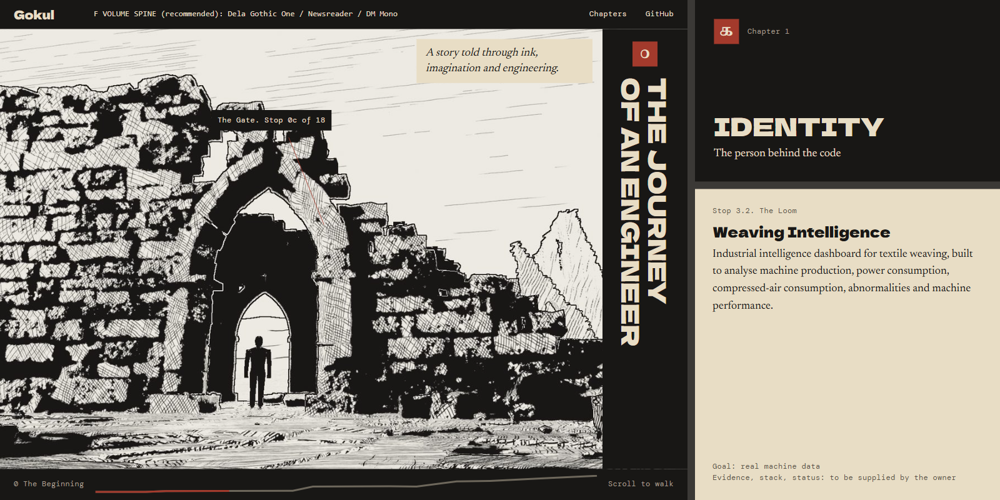

# Creative Direction Reset

**Status: proposal for the owner's approval, updated 2026-11-05 for the manga ink × 1990s painted anime direction.** One throwaway real-time proof exists, on the gate only, in [`reset/gate-proof/`](reset/gate-proof/README.md). No production has started and no other environment has been built. This work did not change the website, Blender scenes or earlier experiments: the proof reads a copy of V7. The V7 figures come from a read-only census of `gothic_study_v7.blend`, which was re-saved at 21:13 on 2026-11-05, outside this work.

Companion document: [CAMERA_PATH_STORYBOARD.md](CAMERA_PATH_STORYBOARD.md).

How to read the claims:

| Tag | Meaning |
|---|---|
| **[M]** | Measured while writing this document |
| **[E]** | Established by the V4–V7 experiments or the Berserk research |
| **[P]** | A prediction. Not yet tested, and it could be wrong |
| **[D]** | A design proposal for you to accept or change |

---

## The answer in one page

> **How can we turn your entire engineering journey into one continuous, immersive, 3D world that moves between ink and painted colour?**

**The whole portfolio is one route through one place. The world begins as a manga drawing, and as you walk, the ink comes alive as light and paint.**

The place is **The Works**: the ruins of a vast, forgotten engineering civilisation, built into a mountain. Its gatehouse is the V7 ruin you already have. You start on a blank page on an open plain, walk through the gate, cross an unfinished bridge, pass through six chambers inside the mountain, one per project, rise up a colossal shaft, come out onto the cliff face, turn around and see everything you just crossed far below, and finish at a lamp on the summit.

Three ideas make it one experience rather than a tour of rooms:

1. **The living front.** The world is one set of geometry that can be drawn in three languages: ink, memory and painted colour. A front spreads through it as you walk: strokes lift off the stone, wash soaks in behind them, paint is laid dab by dab, and later the colour is absorbed back into the blacks. "A story told through ink" stops being a slogan and becomes what is literally happening on screen. Ahead of you, anything not yet loaded is simply *not yet drawn*.
2. **The Red Line.** A surveyor's cord runs the entire route. It is where the front starts, it survives every language, it always shows where the journey goes, and it transforms at every project: into a data cable, one wrong thread in a loom, a ribbon in an archive, a rover's route, a coronary artery, and paths meeting at a stepped tank. A hooded surveyor is laying it, always ahead of you. It ends at your feet, which is what "Contact" means.
3. **The Lamp.** One tiny gold light on the summit, visible from the very first frame. You always know where you are going, and the progress indicator is a drawn section of the climb.

The one moment only a real 3D world can deliver: at Chapter 6 the camera **turns around** and the whole route lies below you, gate and bridge included, with the Red Line running through it. No stack of videos can do that honestly.



*These composition sketches are for judging framing, value and rhythm. Only frame 3 (top row) is a real render. For real art quality, see the proof below.*

---

## The direction update: manga ink × 1990s hand-painted anime

**You asked for this to be proven on the real gate, so it was.** Everything below is an unretouched capture from a live Three.js renderer, on one set of geometry from a copy of V7, with no video and no separate background images. Only the labels were added.



**To see it move, which is what really matters:**

```
node planning/reset/gate-proof/serve.mjs
```

Then open http://localhost:4173 in Chrome and scroll. Keys 1–7 hold each language or show them side by side. I can measure motion but can't watch it, so **your eyes are the test here.**

| The comparison you asked for | Where |
|---|---|
| 1–3. The gate in ink, sepia and anime colour | [Board](reset/gate-proof/captures/05-same-gate-three-languages.png), plus full frames: [ink](reset/gate-proof/captures/01-ink.png), [memory](reset/gate-proof/captures/02-memory-sepia.png), [anime](reset/gate-proof/captures/03-anime-colour.png), [ink night](reset/gate-proof/captures/04-ink-night.png) |
| 4. A continuous transformation | [18 steps, camera still](reset/gate-proof/captures/07-continuous-transformation.png), and [the whole range across one frame](reset/gate-proof/captures/06-continuous-in-one-frame.png) |
| Real camera movement through geometry | [Walking through the gate](reset/gate-proof/captures/08-walking-through-the-gate.png), about 23 m of travel against the old film's 4.26 m |
| Every language from other positions | [Under the arch and in the passage](reset/gate-proof/captures/09-languages-at-other-camera-stops.png) |



### What the proof settled

| Question | Answer | Evidence |
|---|---|---|
| Can the V7 gate run live? | **Yes** | 325,376 triangles and 4 draw calls in a 1.26 MB file, down from 2,077,982 triangles **[M]** |
| Can it hold 60 fps on your laptop? | **Yes, with a lot of room** | 2–4 ms per frame on your RTX 4050 at 1080p, against 16.7 ms available **[M]** |
| Does real-time ink keep V6's character? | **Largely yes, and it is the strongest of the three** | V6's stroke logic is ported directly. Compare [the live frame](reset/gate-proof/captures/01-ink.png) with [the offline one](reset/assets/gate-ink.jpg) |
| Do marks stay still in motion? | **On the numbers, about as well as V7 offline** | Flicker per unit of image change is 0.49 live, against 0.46–0.58 for V7. The same camera rendered twice differs by 0 pixels **[M]** |
| Can three languages share one world? | **Yes** | One G-buffer, with the look chosen per pixel |
| Can transitions avoid looking like a filter? | **I believe so, but you must judge** | Each uses a different mechanism (below). I have only seen stills |

### Where it falls short

- **The anime language is the least finished.** It reads as painted at the first frame, but it does not yet have the richness of a real gouache background. Real brush textures, painted by hand or in Blender, would do more than further shader work.
- **The passage in anime colour is the weakest shot.** Decimated stone close up, with hard dark joints.
- **Up close, the stone is visibly simplified.** The price of going from 2.08M to 325k triangles.
- **A first-time visitor waits 7–17 s for shaders to compile** on this machine, and under 1 s once cached **[M]**. Every real visitor hits this once, so it must be engineered down and designed into the loading page.
- **The figure is V7's mannequin, and it glides ahead of you** with no walk. A placeholder.
- **The ink flecks that become stars are subtle,** and I can't judge them from stills.
- **The Red Line, stakes, clouds and stars are made in code for this proof,** not in Blender.
- **This is one environment,** tested in Chrome only. It says little about the art cost of the other thirteen.

---

## Where the last milestone went wrong

You are right, and the fault was structural, not cosmetic.

| What I built | Why it missed |
|---|---|
| A 10-second film scrubbed inside a page | The 3D world was a picture of a world. Blender became a video generator |
| Prologue and Identity as stacked sections | Scrolling moved the *page*. The camera only appeared to move |
| Oversized Cormorant title | A large serif is the safe default. It said nothing about this world |
| A colour film as the finale | Colour was a video playing at the end, not something happening to the world |
| 4.26 m of camera travel | That is a shot, not a journey **[M]** |

---

## 1. The new visual direction

**A manga illustration you can walk through, which comes alive as painted colour and returns to ink.** It combines two languages: detailed black-and-white manga, and the hand-painted backgrounds of 1990s TV anime.

**This replaces "ink first, colour must not dominate"** from your previous brief, at your request. It also differs from the old monochrome → sepia → colour arc: colour is not one finale, it opens and closes through the journey according to what each chapter means.

### Three languages, on the same geometry

| | **A. Ink** | **B. Memory** | **C. Anime colour** |
|---|---|---|---|
| **Feels like** | A seinen manga page | A remembered, aged photograph | A painted background from a 1990s film |
| **Palette** | Black and parchment | Amber, burnt orange, aged paper | Deep cobalt, muted olive and blue, warm stone |
| **Surface** | V6 strokes anchored to the stone, cross-hatching, solid blacks | Wash pooling into loose steps, faint sepia hatching, a little true colour bleeding through | Limited cel steps with wobbling edges, painted mottling, rain stains, moss |
| **Sky** | Pen-outlined clouds on paper | The same clouds, burnt orange | The same clouds on cobalt, low ones still holding the sun |
| **Depth** | Paper fog with a shaped edge | Warm air | Blue-violet air |
| **Finish** | Paper fibre fixed to the viewer | Paper fibre | Film grain, slight vignette |

**A fourth state I found useful: ink night.** When colour is absorbed back into ink, the sky ends up black, with the same clouds and stars in white stipple. It gives a second, opposite kind of ink, and it is where the Section chapter's white-on-black was already heading **[D]**.

### Transitions

**Each transition uses a different mechanism, and each is tied to the geometry.** All of them run in both directions, so scrolling back reverses them exactly.

| Transition | What physically happens | Status in the proof |
|---|---|---|
| **Ink → Memory** | A front spreads outward from the Red Line. Pen strokes retract along their own length, blacks shrink, and a wash soaks in behind a darker wet edge. Warmth rises from the horizon, and the sky hatching lifts | Built |
| **Memory → Anime** | Paint is laid over the wash in dabs, shadows first. Night arrives from the zenith while low clouds hold the sun longest | Built |
| **Anime → Ink night** | Colour drains darkest-first, and strokes draw themselves over what remains. Black soaks through the cobalt with a stippled edge | Built |
| **Ink strokes → stars** | 2,600 stroke-shaped flecks lift off the stone and fly to fixed places in the sky. In anime they are soft stars, in ink night hard white stipple. Same stars | Built, subtle |
| **Hatching → painted clouds** | There is one cloud field, drawn by each language, so hatched clouds become painted clouds where they stand | Built |
| **Parchment → stone** | Paper shows through until paint and stone colour arrive | Built |
| **Black → cobalt** | Anime → ink night run backwards: black opens into cobalt | Built, on scrolling back |
| **Warm light spreading** | The wash front carries it. The sun itself doesn't move, which keeps it cheap; a moving sun is possible later | Partly |
| **The Red Line** | Starts the front, shifts from oxide to ember to vermilion and back, and is the one colour that survives all four | Built. Its shape doesn't change yet |

**Deliberately absent:** bloom, glow, neon, particle bursts and full-screen colour fades.

### The language score: which chapter speaks which language



Not every environment uses every language. **About 37% of the route is pure ink, 19% memory and 19% anime, with 25% mixed or in transition** **[M: computed from the table below]**. That is a proposal for you to change **[D]**.

| Stop | Language | Why |
|---|---|---|
| **Blank page, Plain, Gate** | Ink | The world begins as a drawing |
| **Through the arches** | Ink → Memory → Anime | **The first awakening.** The signature moment, proven above |
| **1 Identity: Drafting Room** | Memory | The person, the past, one warm lit table |
| **2 Philosophy: Bridge** | Anime fading to ink, then pencil | Built stone is in colour, the unbuilt part is still a drawing. The language **is** the philosophy |
| **3.0 The Mouth** | Colour absorbed to ink | A deliberate return. You enter the mountain in black |
| **3.1 Aira** | Ink, with colour only through the lenses | Perception as the one living thing in the room **[D]** |
| **3.2 Loom** | Pure ink | Colour would ruin the one red thread |
| **3.3 Archive** | Memory | Aged paper is simply what an archive is |
| **3.4 Flood Table** | Ink room, painted table | Cobalt water and small warm lights, like a world seen from above |
| **3.5 Anatomy Theatre** | Ink | Engraving is the native language of anatomy. Red vessels only |
| **3.6 Stepped Tank** | Anime | **The second opening:** real stars in cobalt water, after a long dark |
| **4 Section** | Ink night | White on black, the mountain as its own drawing |
| **5 Terrace** | Memory | Achievements are the past, seen against a burnt-orange sky |
| **6 Look-Back** | Anime, full and largest | **The climax.** The route you walked lies below you, painted because you walked it |
| **7 High Camp** | Anime night | Cobalt, stars, fire. The quiet after the climax |
| **8 Lamp** | Anime → ink night → paper | Colour drains, ink thins, an empty page, the Red Line and one gold point |

**The value arc** still gives the story a shape: the world starts heavy and ends almost blank, with the ink thinning until the last frame is an empty page.

### Boundaries that stay

- No Berserk characters, panels, logos, armour, swords or specific compositions. Scans are never input to any tool.
- **The 1997-era references you sent (five images) are used for language only:** palette, cloud handling, cel limits, line weight and film grain. They are not copied into this repository, and nothing was traced from them. The renderer's only input is your original gate.
- **Compositions to avoid as a result:** a lone figure seen from behind, seated on a rock under stars, is one of your references, so High Camp must be framed differently. A round-towered gatehouse with an arched bridge is another, so the Bridge must not echo it.
- No gore, sexual violence or torture. Menace comes from scale.
- The biggest source of originality is **subject matter**. Looms, surveyors, lenses, archives and anatomy theatres have no equivalent in the reference **[E]**.

**A note on `Downloads/The Journey of an Engineer Storyboard.png`:** I found this file and looked at it. If it is yours, I would not build from it. Its Identity panel shows a spiky-haired, cloaked swordsman-like back view, which sits on our do-not-borrow list. Its "An engineer who sees technology…" text is not from your verified details. And its colour-finale structure is what you just rejected.

---

## 2. The world: The Works





| Fact | Value |
|---|---|
| Route length | 1,792 m **[M: computed from the waypoints]** |
| Climb | 338 m **[M]** |
| Scroll length | 388 wheel notches: 166 travelling, 222 dwelling **[M]** |
| Equivalent | About 36 screens of native scroll at 1080p **[M]** |
| Non-stop time | About 2¼ minutes at 3 notches a second **[P]** |

**Regions, in order:**

| Region | What it is | Light and value |
|---|---|---|
| **The Plain** | Open ground and the first view of everything to come | Nearly blank paper |
| **The Gatehouse** | The real V7 ruin and its bent passage | Heavy black against paper sky |
| **The Gorge** | A chasm crossed by a bridge that is still being built | Fog bands, extreme scale |
| **The Undercroft** | Six chambers inside the mountain | Black, each with one light source |
| **The Section** | A vertical shaft where the mountain becomes its own drawing | Inverted: white line on black |
| **The South Face** | Terrace and cliff road in open air | Pale, windy, first sepia |
| **The Summit** | High camp and the Lamp | Ink thinning to nothing |

**Why a mountain with the destination on top:** progress must be readable without explanation. Climbing is universally understood, and a light on a summit is a clear goal. Games such as *Journey* use the same principle, a distant landmark you can always see.

---

## 3. The camera journey

Full frame-by-frame detail is in the [storyboard](CAMERA_PATH_STORYBOARD.md).

**One take, on rails.** The camera follows one authored path. There is no free flying, no orbit control and no way to get lost. The only freedom is a small pointer parallax of about ±1.5° **[D]**, which makes the world feel alive at rest. The one exception is the heart, which you can turn at its stop.

| Notches | Chapter | Place | Camera idea |
|---|---|---|---|
| 0–42 | 0 The Beginning | Blank page, plain, Gate | Page inks in. Long push. Real V7 move. Through both arches |
| 42–68 | 1 Identity | Drafting Room | Enters black room, settles on one lit table |
| 68–116 | 2 Philosophy | Unfinished Bridge | Swings out over the gorge, returns to the deck, walks into the unfinished part |
| 116–128 | 3 threshold | The Mouth | Strict frontal push into one black slit |
| 128–150 | 3.1 Aira | Watch-House | Looks straight up into a dome of lenses |
| 150–176 | 3.2 Weaving Intelligence | The Loom | Fast one-point run down the warp, then stops |
| 176–200 | 3.3 LearnQuest | Trial Archive | Cranes up through a tree of stairs |
| 200–220 | 3.4 RescueCore | Flood Table | High, tactical, dollies along a rail |
| 220–242 | 3.5 CAD | Anatomy Theatre | Descends tiers. You can rotate the heart |
| 242–262 | 3.6 InaippuAI | Stepped Tank | Symmetric crane into converging flights |
| 262–292 | 4 Engineering | The Section | Long-lens vertical rise, value inverts |
| 292–314 | 5 Recognition | Terrace of Seals | Low angle, wind, standards |
| 314–350 | 6 Journey | The Look-Back | Climbs, stops, and turns around |
| 350–368 | 7 Beyond Code | High Camp | Almost still. The relief scene |
| 368–388 | 8 Contact | The Lamp | Ink thins out. The Line runs off the page |

### How the wheel drives it

You asked that the wheel moves the camera and does not scroll HTML sections. There are two ways to do that, and I recommend the first.

| | **A. Native scroll as input (recommended)** | B. Capture wheel events |
|---|---|---|
| How | Canvas fixed to the window. A tall, empty element gives the page scroll length. Scroll position drives the camera | Page does not scroll. JavaScript intercepts the wheel |
| What you see | **Identical:** only the camera moves | Identical |
| Trackpad inertia, keyboard, scrollbar, deep links, reload position | All work for free | All must be rebuilt, and usually feel slightly wrong |
| Project rule 3 | Keeps "no scroll hijacking" | Breaks it |

**Deliberate pauses without locking anything.** The journey position is a curve over scroll. Across a dwell range the curve goes nearly flat, so scrolling continues normally while the camera barely moves and the text has time to be read. Nothing snaps or stops the wheel **[D]**.

**Controlled acceleration.** The camera chases the scroll target with a critically damped spring of roughly 350 ms, with speed limits of about 15 m/s outdoors and 6 m/s indoors **[P: to tune by feel]**.

**Where the route is too long for that.** At full wheel speed some stretches would pass those limits. Between chambers the path passes through a duct of pure black, a **gutter** like the gap between manga panels. A jump hidden inside a few frames of solid ink feels continuous, and it also hides the swap between loaded environments. Stretches I expect to need it: every link between chambers 3.1–3.6 **[P]**.

### Transitions are part of the story

Each one is continuous, and most use the Red Line:

| From → to | Transition |
|---|---|
| Page → Plain | Pencil lines ink in on load |
| Gate → Drafting Room | Through two arches, into black |
| Room → Bridge | Out through a breach into blinding paper-white, gorge below |
| Bridge → Mouth | Stone gets paler and less finished, then one black slit |
| Aira → Loom | The cable feeds into a duct and comes out as a single warp thread |
| Loom → Archive | That thread winds onto a bobbin and becomes a book's ribbon marker |
| Archive → Flood Table | The ribbon marks a place on a map, and the map is the table |
| Flood Table → Anatomy | **Match cut.** Close on the branching flood channels; pull back and they are coronary vessels |
| Anatomy → Stepped Tank | Vessels become water channels feeding a stepped tank |
| Tank → Section | Four lines join into one and rise up the shaft |
| Section → Terrace | White-on-black drawing burns out to daylight |
| Road → Look-Back | The first and only time the camera turns to face where it has been |
| Lamp → Page | Paper fog closes over everything. The Line carries on past the frame |

---

## 4. The storyboard

See **[CAMERA_PATH_STORYBOARD.md](CAMERA_PATH_STORYBOARD.md)** for 20 frames with camera position, lens, move, scroll range, type of darkness and transition out.

---

## 5. How each chapter is represented

Every fact below comes from `MY_PROFILE.md` or `PROJECTS.md`. **Text is real HTML placed over the world, never baked into images.** It sits on solid plates beside the art, and thin red leader lines tie it to objects in 3D **[D]**.

| Stop | Place | Why this metaphor | What it can say today | Still needed from you |
|---|---|---|---|---|
| **0 The Beginning** | Gate | Entering a world someone else abandoned | Title and supporting line | |
| **1 Identity** | Drafting Room: one lit table where the Line becomes a drawing | The person is revealed through their desk, not a portrait | Name, CSE — AI and Data Science, BIT, Tamil Nadu, expected Sept 2028, GitHub, interests | Exact degree title, your own one-line description |
| **2 Philosophy** | Unfinished Bridge: stone gives way to scaffold, then to pencil | Things exist as drawings before they exist as stone | Working style only: AI-assisted development, Claude Code as primary partner | **3–4 principles in your words.** Four piers wait for them |
| **3.1 Aira** | Watch-House: many lenses, each looking its own way, all cabled to one index drum; the floor is a map | Agents, vision and spatial memory that "remembers places" | Agentic ecosystem, FastAPI, vision, contextual reasoning, spatial memory, FAISS, safety prioritisation, Flutter | Purpose, architecture, role, repo, demo, status |
| **3.2 Weaving Intelligence** | The Loom: thousands of warp threads in one-point; pressure vessels along the walls; **one thread is red** | That thread is an abnormality found in machine data. The strongest image in the set | Textile dashboard: production, power, compressed air, abnormalities, performance; real machine data as the goal | Stack, deployment, findings, confidentiality |
| **3.3 LearnQuest** | Trial Archive: stairs branching like a document tree | Its evaluation works on the DOM, so the building is one | Gamified learning and assessment, React, Node.js, MySQL, HTML/CSS/JS challenges, live previews, DOM and visual evaluation, proctoring | How evaluation works, role, repo, demo |
| **3.4 RescueCore** | Flood Table: drowned district at model scale, masts, a lantern rover | A command view of disaster, without showing suffering | AI disaster-management command portal, IoT, React interface, **ESP32-CAM rover concepts, labelled as concepts** | What is built vs concept, AI role, photos |
| **3.5 CAD** | Anatomy Theatre: tiers falling to a lit well, engraved heart, vessels in red. **Real interactive 3D** | Historic anatomical theatres are a real, dramatic building type, and engravings are native to ink | CAD concepts, vessel visualisation, 3D anatomical assets, interactive Three.js | Model source and licence, whether detection exists, medical disclaimer wording |
| **3.6 InaippuAI** | Stepped Tank: flights from four sides meet at one platform | Paths converging; a form from your part of the world (decision 4) | India-focused connection app, Flutter, credit-based monetisation, subscriptions, React admin | Status, store link, screenshots. Confirm "inaippu" means connection, as I assume |
| **4 Engineering** | The Section: the mountain's own engineering drawing, white on black | The one place depth is shown openly | Stacks from the verified projects, grouped by area | Your tool list. No proficiency levels until you supply them |
| **5 Recognition** | Terrace of Seals: three standards in open wind | Achievements as markers planted on a climb | Winner, TCS Technology Day 2026 AI Hackathon, Team NPC. First prize, paper presentation, Fiestaa'25. Finalist, HackXelerate '25. Vice Chairman and Digital Lead responsibilities, IEEE BIT | Dates, evidence, exact IEEE wording. **Internship terms stay unstated** |
| **6 Journey** | The Look-Back: the whole route below you | Growth is only visible from higher up | BIT, expected Sept 2028 | Real dates. No invented timeline |
| **7 Beyond Code** | High Camp: fire, stars, pack set down | The relief scene. The only place the surveyor stops carrying things | Almost nothing is verified | **All of it.** Until then the scene runs almost wordless, and that works |
| **8 Contact** | The Lamp, then an empty page | The Line ends where you are standing | GitHub | Email, LinkedIn, resume |

**Characters:** the **Wanderer** is an original hooded surveyor: tall frame pack over one shoulder, one straight iron staff. He stands at each stop, already there, and you keep catching up. Static poses avoid the cost and uncanny look of walk cycles **[D]**. The **Spark** is a small glass-bodied lamp creature, the only gold thing that moves. Whether the Wanderer is you is still open (decision 5).

---

## 6. Rendering: approach and feasibility

### What we already know



*Built from your real V7 passes, frame 60 **[M]**. Panels 1 and 2 use the monochrome render's light. The ink frame's own lighting is paler, so real-time tone must be set up for ink first.*

- **The look separates into data.** Tone, stepped bands, contours and surface marks. Each is something a shader can reproduce **[M]**.
- **The V6 marks use no UVs or image textures.** They are computed from world position and surface direction **[M: read in `v6_ink.py`]**, which ports to GLSL directly.
- **Surface-anchored marks are essential.** They swim about 12× less than screen-fixed marks: 0.086 against 1.062, with flicker 1.20 against 10.18 **[E: V5]**.
- **Marks must fade by distance.** V6 brings finer rows in as the camera approaches, so density on screen stays even **[E]**.

### What the proof measured

Before this proof, real-time ink had never run, and this section was all prediction. Now it is measured for one environment. Numbers come from Chrome on your laptop, with `readPixels` forcing each frame to finish, so queued work can't flatter them **[M]**.

| Setup | Time per frame, across all languages and transitions, two runs | Frame rate |
|---|---|---|
| **RTX 4050, 1920×1080** | **About 2–4 ms** | Far above 60 fps |
| RTX 4050, 2560×1440 | About 3–7 ms | Far above 60 fps |
| Intel UHD integrated, 1920×1080 | About 12–29 ms, varying a lot between runs | Roughly 35–80 fps, not a safe 60 |

| Other measurements | Value |
|---|---|
| Triangles, draw calls | 325,376, 4 |
| File size | 1.26 MB, against a predicted ≤6 MB for a hero chunk |
| Worst one-off stalls | Up to about 41 ms on the RTX 4050, in single frames |
| First load, shaders not cached | 7–17 s, mostly shader compilation |
| First load, shaders cached | Under 1 s |
| Mouse wheel | Walked to 100% and back to 0% with real wheel input, no console errors |

**Why it is so much cheaper than I predicted:** each pixel is shaded once, all soft noise comes from one baked 3D texture, shadows are baked once at load, and only the languages visible in a stage are computed.

**Caveats:** one small environment, with four draw calls. Chrome only. A hot laptop will vary, which probably explains the spread between runs. Motion smoothness is unjudged by any human until you try it.

### The pipeline as built

| Step | Technique | Status against my earlier prediction |
|---|---|---|
| **1. Tone** | Occlusion and sky visibility baked per vertex in Blender, by ray casting | As predicted |
| **2. Shadows** | One static shadow map per language, rendered once at load | **Changed.** They cost nothing per frame, and let each language have its own light |
| **3. Blacks** | From light and occlusion, broken by marks fixed to the stone | Works. **Hand-placed blacks are still untried** and would raise the quality |
| **4. Hatching** | **V6's stroke logic ported directly to GLSL**, with a continuous row level-of-detail | **Changed.** I predicted tonal art maps would be needed. They were not |
| **5. Mark direction** | Per material, with per-stone rotation | As predicted |
| **6. Contours** | Laplacian of inverse depth, as V6 did. Flips to paper over solid black | As V6 |
| **7. Paint** | Smooth normals for colour, flat normals for ink, from the same mesh | **New.** Smooth normals removed the triangle facets in colour; flat ones help ink look chipped |
| **8. The front** | Distance from the Red Line, baked per vertex at load, broken by noise | **Changed** from distance to the camera |
| **9. Sky** | One baked cloud field, read by each language | New |
| **10. Stars** | 2,600 points, each travelling from a place on the stone to a fixed place in the sky | New |
| **11. Finish** | Paper fibre or film grain by language | As predicted |

**What I would avoid, and why:**

| Option | Verdict |
|---|---|
| Generic toon shader | You ruled it out, correctly |
| Screen-space hatching (as in the well-known Moebius-style shader) | Its Sobel outline method is useful, but its stripes are computed in screen space, which is exactly what V5 measured swimming 12× worse |
| Blender Line Art or Freestyle at runtime | Offline only |
| Stochastic halftone everywhere | Flickers in motion, as *Return of the Obra Dinn* had to solve with custom stabilisation. Use it only for sky tone |
| `@react-three/postprocessing` for the ink pass | Heckel's article reports it doesn't support custom passes, so a small hand-written pass is cleaner |

**Known problems to carry over from V7** **[E]**: floor hatching compresses at grazing angles and looks busy (fade marks by viewing angle, and leave lit floor open). A contour line crosses the gate from a far hill (exclude far hills from contour IDs). Speckle at soft shadow edges (baked tone should solve it).

**Honest limit:** a real-time shader will not match the density of the best panels in the reference. I would add hand-authored ink decals, such as cracks and ivy clumps, at focal points, and hand-painted texture sets for the anime language.

---

## 7. Typography redesign

Six systems rendered with the real fonts on your real ink frame **[M]**. Please compare the images, not my descriptions.

| Board | System | My read |
|---|---|---|
| [A Cut Stone](reset/type/A-cut-stone.png) | Grenze Gotisch, Source Serif 4, Spline Sans Mono | The most world identity. Risks reading as a fantasy fan site, and its capital I is ambiguous |
| [B Seinen Block](reset/type/B-seinen-block.png) | Dela Gothic One, Zen Kaku Gothic New, JetBrains Mono | Real manga-cover weight. A solid mass against delicate hatching. Feels engineered |
| [C Archive Press](reset/type/C-archive-press.png) | IM Fell Great Primer SC, Newsreader, DM Mono | Lovely real-letterpress texture, but it is still a bookish serif, close to what you rejected |
| [D Engraver](reset/type/D-engraver.png) | Texturina, Literata, Fragment Mono | Weak as a face. Its **vertical spine title** is the best compositional idea |
| [E Brush and Seal](reset/type/E-brush-and-seal.png) | Yuji Boku, Spectral, Martian Mono | Too casual, closer to comedy than seinen. Rejected |
| [**F Volume Spine (recommended)**](reset/type/F-volume-spine-recommended.png) | **Dela Gothic One, Newsreader, DM Mono** | B's weight in D's composition |

[All titles side by side](reset/type/titles-side-by-side.png), including the current Cormorant for comparison.



### The recommended system [D]

**The idea: type behaves like the spine and margins of a manga volume.** It stands beside the art, never on top of it.

| Role | Treatment | Size at 1080p |
|---|---|---|
| **Title** | Dela Gothic One, uppercase, vertical on an ink spine at the right edge, with a seal above | 39 px |
| **Chapter opener** | Small seal and number, then one word, in a black gutter between environments. A breath, not a poster | 40 px |
| **Project name** | Dela Gothic One, mixed case | 23 px |
| **Reading text** | Newsreader on a solid parchment plate | 18 px |
| **Annotation** | DM Mono, sentence case, attached to a 3D object by a thin red leader | 13 px |
| **Navigation** | Wordmark in Dela Gothic One, the rest in DM Mono | 13–19 px |
| **Progress** | The section drawing with the Red Line as far as you have walked | 30 px tall strip |

**The largest type on any screen is about 40 px.** The world is the spectacle. That is the opposite of the current site's 175 px title.

**The seal:** a small oxide square carrying the chapter number in **Tamil numerals** (௦ ௧ ௨ ௩ …), instead of borrowing Japanese characters. It takes the manga convention and makes it yours. Please check that this feels right to you and that the numerals are correct (decision 4).

**Contrast [M]:**

| Pair | Ratio | Verdict |
|---|---|---|
| Parchment on ink | 13.29 | Passes |
| Muted on ink | 6.67 | Passes |
| Red `#A33A2C` on parchment | 4.87 | Passes |
| Red `#A33A2C` on ink | **2.73** | **Below the 3:1 guideline for graphics.** A brighter `#B8432F` calculates to about 3.3. To settle at the next gate |
| Token oxide `#702B2B` on ink | 1.77 | Vanishes. Why the Line can't use it in the dark |

These fonts are all on Google Fonts. Licences are to be confirmed before use.

**The hybrid direction doesn't change this recommendation.** Type sits on solid plates beside the art, so cobalt and amber don't affect its contrast. I have not yet tested the Red Line against cobalt as a leader line, and thin red on deep blue may vibrate.

---

## 8. Blender to Three.js pipeline

**Blender is where the world is made.** Three.js only displays it.

```
Kit library  →  Environment chunks  →  Bake and tag  →  Export  →  Optimise  →  Budget check  →  Browser
```

| Stage | What happens |
|---|---|
| **Kit** | A reusable Blender library: stone blocks, arches, piers, stairs, timber, rubble, gears, lenses, loom parts, and the Wanderer's poses. Procedural, and built for instancing |
| **World layout** | One master file linking the kit, with the whole route blocked out at true scale **before any detail**, and every sight line checked: Lamp from the plain, gate from the Look-Back |
| **Chunks** | 13 streamable pieces plus an always-loaded far silhouette of the mountain |
| **Camera** | A Blender curve and rig with stops marked, exported as positions, rotations and focal lengths along the path, as V7's `camera_path.json` already does |
| **Bake** | Light, shadow and painted blacks into one vertex channel; a lightmap only for hero surfaces |
| **Tag** | Per-object attributes: mark direction, material ID, contour on or off |
| **Export** | Scripted per chunk. Reproducible, never by hand |
| **Optimise** | `gltfpack` with meshopt compression and GPU instancing (`-cc -mi`). Three.js decodes with `MeshoptDecoder` |
| **Budget check** | A script fails the build if any chunk is over budget |

**Safety and practice:**

- New files only. V3–V7 stay untouched, and V7 is copied, never edited.
- Long renders and bakes run headless with `-S <scene>`, because MCP calls over about 3–4 minutes drop and headless renders of a non-active scene freeze the camera **[E]**.
- Every asset gets recorded in the inventory with its provenance.

### The biggest production fact

**V7's ink scene was 2,077,982 triangles. The proof runs it at 325,376, in 1.26 MB, using decimation alone [M].** That is well below my earlier 6 MB allowance, and decimation stays acceptable except up close. Kit-based instancing is still the plan for the other environments, because a hero chunk can afford more detail where the camera comes near.

### What else the scene can't do yet **[E]**

- The sky card covered about 43% of a full turn. **The proof replaces it** with a sky computed in every direction.
- Distant hills show tiling up close.
- The figure is a plain mannequin.
- Stone fractures are partly shading rather than geometry.

---

## 9. Performance and interaction

### Budgets [P, except where section 6 now gives a measurement]

The proof uses only about a quarter of the frame budget below, so there is room for denser environments and hand-painted textures. **The binding constraint has moved from frame time to first-load shader compilation.**

| Item | Target |
|---|---|
| Frame rate on your RTX 4050 at 1080p | Steady 60 fps, about 8 ms of GPU time for headroom |
| Triangles drawn | ≤ about 700k at once |
| Draw calls | ≤ about 120 |
| Chunks in memory | Current, next, previous, plus the far silhouette |
| Hero chunk | ≤ about 6 MB |
| Before the world can start | ≤ about 8 MB |
| Whole world, streamed over the route | ≤ about 55 MB |

The compression ratio is unknown: meshoptimizer publishes no reliable figure, so these sizes must be measured. Lighthouse scores won't drive decisions, as you asked. **Hard limits are frame rate and readable text.**

**Normal desktop hardware** needs a quality ladder, reducing in this order: wobble, then second hatch family, then far detail, then resolution last. Line art suffers more than most art from low resolution **[D]**. Rendering pauses when the camera is settled and nothing is moving.

### Stack

| Package | Current version | Use |
|---|---|---|
| `three` | 0.187.0 | Renderer, WebGL2 |
| `@react-three/fiber` | 9.8.2 | Accepts React ≥19 and <19.4, so the project's 19.3 fits **[M]** |
| `@react-three/drei` | 10.7.9 | Only if a helper earns its place |
| `gsap` | 3.15.1 | Already installed. For the text and overlays, not the camera |
| `gltfpack` | 1.3.0 | Build-time only |

Multiple render targets for the G-buffer are confirmed in current three.js documentation, and R3F lets a custom pass take over the render loop through `useFrame` priority. **Three.js and R3F add perhaps 200 KB gzipped [P]**, loaded after the first paint.

### Interaction

| Need | Design |
|---|---|
| **Loading** | Compile the ink language first and start the walk in ink, then compile memory and anime in the background using the browser's parallel compile extension **[P]**. A parchment page. The Red Line draws across as assets arrive, then the first lines of the plain ink in. Late chunks are simply "not yet drawn", with no spinner |
| **First instruction** | "Scroll to walk", once, until the first notch |
| **Progress** | The section drawing along the bottom, Red Line up to your position, ticks at each stop |
| **Chapter navigation** | Hover a tick for its name, click to go. A jump **does not fly**: the page washes to ink and back in about 500 ms |
| **Keyboard** | Space and PageDown from native scroll; number keys 0–8 for chapters; M for the map; Esc closes an open plate |
| **Reading detail** | Plates appear during a dwell. A project plate can open into a parchment dossier with the evidence and links |
| **Feedback** | Red leader thickens on hover and focus; the object it points to is slightly less hatched, so it lifts forward |
| **Reduced motion** | No continuous camera. Each notch range cross-fades in ≤150 ms between fixed framings of each stop |
| **No WebGL, or too slow** | The **Reading View**: every word as ordinary HTML, with pre-rendered stills from the same world |
| **Recruiters and screen readers** | The same Reading View, linked as the first thing keyboard users reach and from the Chapters menu. One content source, so the two can't drift apart. The canvas is hidden from assistive technology |
| **Sound** | None for now |

The Reading View isn't the section-based site by another name. It is the fallback, and the world is the portfolio. Without it, a recruiter in a hurry or a screen-reader user would get nothing, and your own original goal was "find projects in under 30 seconds".

Mobile is deferred, as you asked. Small screens get the Reading View until we return to it.

---

## 10. What to reuse and what to replace

| Existing work | Decision | Why |
|---|---|---|
| Berserk research notes | **Keep** | Still the design basis for values, composition and scale |
| V6 stroke logic (`v6_ink.py`) | **Keep. Ported and working** | The mark language you prefer |
| V7 gate geometry and composition | **Keep, rebuilt for real time** | The first stop. Source file untouched |
| `camera_path.json` format and path | **Keep** | The real move for stop 0c |
| V7 monochrome and sepia renders | **Repurpose** | Reading View stills only. The route's sepia is now real-time |
| V7 colour film and scrubber | **Retire from the route** | Your brief rules out pre-rendered MP4 as the main experience. Files stay, unmodified |
| Ink-to-mono wipe from V6 | **Keep the idea** | Direct ancestor of the living front |
| V7's colour-stage palette work | **Reference only** | The proof's anime language was built fresh, because it must run live |
| The gate proof | **Keep as reference, then discard the code** | Throwaway. Its decisions carry forward, and production rewrites it in R3F |
| Content model and `verified` flags | **Keep** | The rule against invented claims matters more now |
| Test setup, contrast tests, scripts | **Keep** | Still correct |
| Design tokens: palette | **Keep, add red and gold** | |
| Cormorant and current type system | **Replace** | Section 7 |
| Prologue and Identity section layouts | **Replace** | They become the Reading View's starting point at most |
| Chapter rail and header | **Replace** | The section drawing replaces the rail |
| Next.js project and build | **Keep** | |
| Film scrubber, 13.6 MB download | **Retire** | |
| Project docs that say otherwise | **Update after approval** | See below |

### Earlier rules this direction changes

I have not edited these. They should change only after you approve.

| Rule | Where | Now |
|---|---|---|
| "Phase 1, desktop implementation" and "Prologue and Identity are built" | `CLAUDE.md` | Update the phase |
| "Prefer CSS/SVG/video over WebGL" | `CLAUDE.md` rule 6, `TECH_STACK.md` | WebGL becomes primary, justified |
| "Heart = WebGL; all other 3D = pre-rendered" | `TECH_STACK.md` | Reversed |
| "Monochrome → sepia → color" and "Colour = earned understanding" | `PORTFOLIO_VISION.md`, `DESIGN_SYSTEM.md` | Three languages by chapter, section 1 |
| "Text always on a plate" | `DESIGN_SYSTEM.md` | **Unchanged.** It still works |
| "Vertical native scroll only. No scroll hijacking" | `CLAUDE.md` rule 3 | **Kept,** if you accept the recommended wheel mechanism |
| Nine chapter sections on a single page | `EXPERIENCE_MAP.md`, `WIREFRAMES.md` | Become stops on one route |
| Fonts and sizes | `DESIGN_SYSTEM.md` | Section 7 |
| "Game-like mechanics" as a non-goal | `PORTFOLIO_VISION.md` | **Unchanged.** On rails, with no controls to learn |
| Performance targets for phones | `TECH_STACK.md` | Deferred |

---

## 11. How I would build it, if you approve

Fourteen environments is a very large art job, so each gate must earn the next.

| Gate | What gets made | You decide |
|---|---|---|
| **0 The language proof: built, awaiting your verdict** | The V7 gate only, live, in ink, memory and anime, with transitions, Red Line, stars and wheel control | **Does this look and move like the world you want?** |
| **1 Vertical slice** | Plain → Gate → Drafting Room → first half of the bridge, with wheel control, type system, one text plate and loading | Does the experience feel right? |
| **2 Whole-route blockout** | Grey boxes, the entire 1.8 km in ink, every camera move and pause, all real text | Pacing and the Look-Back, before any detail |
| **3 Hero environments** | Gate, Bridge, Loom, Anatomy Theatre, Look-Back | Quality bar |
| **4 Remaining environments** | Watch-House, Archive, Flood Table, Stepped Tank, Section, Terrace, Camp, Lamp, at a simpler level | |
| **5 Hardening** | Reading View, reduced motion, other browsers, other GPUs | Launch |

**If the proof's look or motion fails for you,** speed gives us room to respond: denser geometry, hand-painted textures and hand-placed blacks are all affordable. If the shader approach itself is wrong, the fallback is more baked art in textures, costing some flexibility.

**The Whole-route blockout also protects scope.** If fourteen is too many, chambers can merge at that stage, before expensive art is made.

**Main things that could go wrong:**

| Issue | Response |
|---|---|
| Ink or paint looks mechanical | Your verdict on the proof, hand-placed decals, hand-painted texture sets |
| Long first load while shaders compile | Compile ink first, the rest in the background; simplify shaders; loading designed as part of the world |
| Too many transitions feel like a trick | The language score keeps them rare. Use fewer if the signature wears off |
| Scene too heavy after decimation | Kit and instancing, chunks, far silhouettes |
| Fast scrolling feels nauseating | Speed limits, gutters, testing by feel at Gate 1 |
| Motion is judged by a person, and I can't watch it | You judge at every gate. I measure frames, and I have never been able to watch these play |
| Reading text over a moving world | Plates only appear in dwells; text never sits on art |
| Too long for a hurried recruiter | Chapter jumps and Reading View |
| Slow on integrated graphics | Quality ladder, then Reading View |

---

## 12. Decisions for you

**The main one:**

1. **The proof.** Run it, scroll it, and tell me: is this the world? Which language or transition feels wrong?

**Then, on the hybrid direction:**

2. **Ink night.** Keep it as a fourth state? I recommend yes: it is one of the best frames in the proof.
3. **The language score.** Do you agree with which chapter speaks which language? In particular, the Bridge and the Look-Back.
4. **Anime language.** Would you rather I keep it this close to the first frame, or push further towards gouache with hand-painted texture sets? I recommend pushing further, at the next gate.

**Still open from before:**

5. **The world.** Do you approve The Works: one route, living front, Red Line, Lamp?
6. **The wheel.** Native scroll as the hidden input (recommended, and what the proof already does)?
7. **Typography.** F Volume Spine (recommended), or another board?
8. **Tamil touches.** A stepped tank, and Tamil numerals on the seals? I recommend both. I would use secular building forms and no religious imagery. Is this right for you?
9. **The Wanderer.** Fictional surveyor (recommended), or you? Does the hood ever come off?
10. **Reading View.** I strongly recommend it for recruiters and accessibility. Are you comfortable with it existing as a secondary link?

**Nothing beyond the proof has started, and nothing will until you approve.**

**Content that only you can supply**, and which can arrive at any time:

- Your engineering principles.
- Beyond Code: anything at all.
- Contact details.
- Project evidence: repos, demos, roles, status.

## Assumptions

- All world coordinates, budgets and scroll figures are proposals. The route numbers are computed from those proposed waypoints.
- Only the gate's figures are measured. Everything about the other environments is still a prediction.
- The proof's route and Red Line are for the gate only. Its camera route differs from storyboard W3–W4, because the inner gate is really at about (−12.1, 15), not (−6, 15.5) as `route.mjs` has it. To correct at the blockout gate.
- "Inaippu" means connection: my understanding, not stated in your documents.

## Sources

- Praun, Hoppe, Webb, Finkelstein, [Real-Time Hatching](https://gfx.cs.princeton.edu/proj/hatching), SIGGRAPH 2001: tonal art maps.
- Maxime Heckel, [Moebius-style post-processing](https://blog.maximeheckel.com/posts/moebius-style-post-processing/): Sobel outlines with wobble; reports the custom-pass limitation.
- [PC Gamer on *Return of the Obra Dinn*](https://www.pcgamer.com/lucas-pope-on-the-challenge-of-creating-obra-dinns-1-bit-aesthetic): secondary source on dither stabilisation.
- [meshoptimizer gltfpack documentation](https://meshoptimizer.org/gltf/): `-cc` and `-mi` flags.
- [three.js multiple render targets example](https://github.com/mrdoob/three.js/blob/dev/examples/webgl_multiple_rendertargets.html) and [R3F hooks documentation](https://github.com/pmndrs/react-three-fiber/blob/master/docs/API/hooks.mdx).
- V4–V7 reports in `blender_scratch`, and `References/berserk/`.
- Five reference images you sent on 2026-11-05: used for visual language only, not stored in this repository.
- [three.js 0.187.0](https://github.com/mrdoob/three.js), MIT licence, vendored in the proof. [gltfpack 1.3.0](https://meshoptimizer.org/gltf/) for compression.
