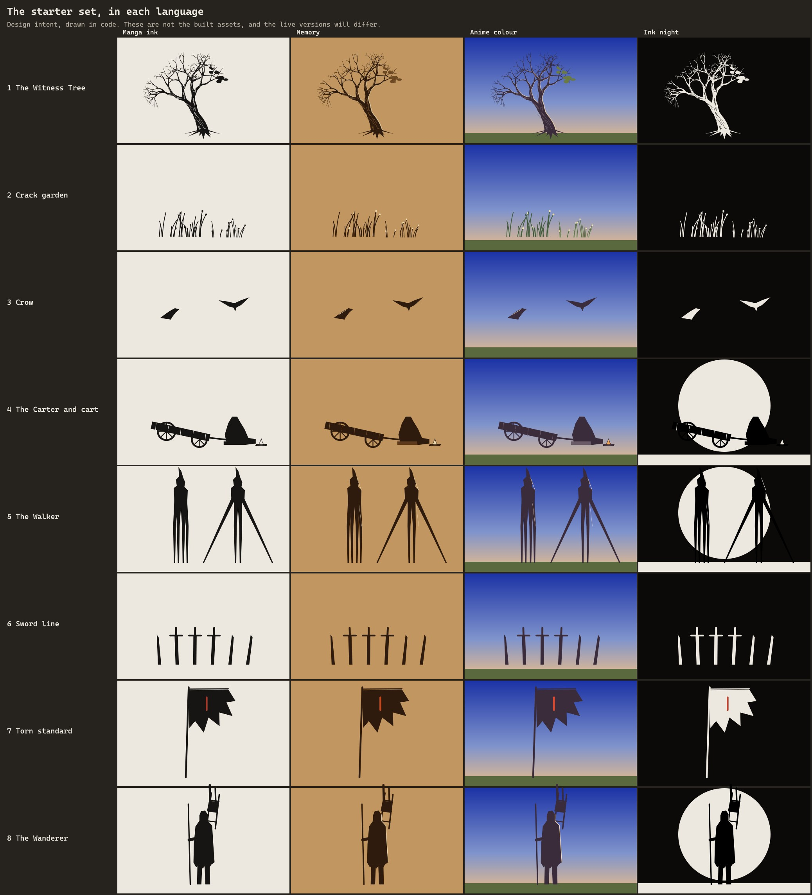

# Environment Asset Inventory

**Status: a proposal. No assets have been made.**

> **Updated 2026-11-06:** the owner switched to a hybrid asset strategy. Sources for the tree, crow, cart, swords and figures now come from downloads, customised in Blender, and the triangle figures below are superseded. See [ASSET_SOURCING_STRATEGY.md](../../ASSET_SOURCING_STRATEGY.md), [ASSET_CANDIDATE_CATALOG.md](../../ASSET_CANDIDATE_CATALOG.md) and [ASSET_PERFORMANCE_BUDGET.md](../../ASSET_PERFORMANCE_BUDGET.md). The story, roles and four-language table here still stand. Companion to the [environment storyboard](ENVIRONMENT_STORYBOARD.md).

## What exists today

From reading the first proof's code and exporting its geometry **[measured]**:

| Kind | What | Notes |
|---|---|---|
| **Real 3D from Blender** | Hero arch, inner gate, walls, wall cores, passage, rubble, debris, foreground ruin, flagstones, soil, terrain, far tower, far gable, far wall | 325,376 triangles, 1.26 MB, 4 draw calls. Each vertex holds baked occlusion, sky visibility, a material ID and a per-stone value |
| **Procedural geometry in code** | Red Line tube, stakes, 2,600 star points | Built at load |
| **Shader effects, no geometry** | All four languages, hatching, contours, clouds, moon, moss, rain stains, fog, grain, transition fronts | One cloud field and one 3D noise texture, both baked at load |
| **Placeholders** | The figure, V7's plain mannequin, which glides. Found in the shader by a position box, which won't scale | Replace |
| | The far wall, a flat band | Replace with ridges |
| | Terrain that ends at y = −35 | Extend |

**Animated today:** camera, language, the figure's glide, star flight and twinkle, cloud drift, film grain. Nothing else in the world moves, which is why it feels empty.

---

## The starter set: validate these first

**You asked for one of each before expanding. This is that set, plus the Wanderer, which I am asking to add.**

*Design intent, drawn in code. These are not the built assets.*

| # | Asset | Why it exists | How it's made | Size budget | Moves how |
|---|---|---|---|---|---|
| 1 | **The Witness Tree** | The landmark of the first half. The oldest living thing here, grown through the wall. One bough still has leaves | Blender: scripted skeleton, swept into a mesh, then edited for silhouette. Roots actually grip V7's stones | 12k triangles near, 4k mid, 1 card far | Sway in the wind, by height. Living bough moves more |
| 2 | **Crack garden** | The world is taking the gate back. Sits where the sword line meets the threshold | Blade and stem cards, instanced | 2,000 instances, 6 triangles each | Wind ripple travelling across the patch |
| 3 | **Crow** | First thing that reacts to you | Blender: one low mesh, wings flap in the vertex shader, no skeleton | 200 triangles, instanced ×30 | Perch idle, take-off, flight, landing |
| 4 | **The Carter and cart** | Curiosity. Someone is still here, and doesn't explain why | Blender: hooded seated figure, cart with one wheel off | Figure 3k, cart 3k | Head turn, fire flicker |
| 5 | **The Walker** | The one creature, and the slow discovery | Blender: stilts and a hooded column, under 2k triangles, because it is only ever far away | 2k, no textures | One step. Otherwise perfectly still |
| 6 | **Sword line** | The history of the gate, in one row | Blender: 3 blade variants, instanced | 150 triangles each, ×9 | None |
| 7 | **Torn standard** | Someone held this place. Gives the wind something to show | Blender: pole and torn cloth | 800 triangles | Cloth wave in the vertex shader, driven by wind |
| 8 | **The Wanderer** *(added, decision 1)* | The emotional centre. A mannequin would undercut everything around it | Blender: coat, frame pack, iron staff, simple rig | 6k | Walks when you scroll, stands when you stop, turns at the Look Back |

**Total added: about 46k triangles** if everything is in view at once, on top of 325k.

**You asked for three props; these are three:** the cart, the sword line and the standard.

### How each one speaks the four languages

The renderer already draws anything in all four, as long as it writes the right data. So this is one mesh with a material setting, never four assets.

| Asset | Ink | Memory | Anime colour | Ink night |
|---|---|---|---|---|
| Tree | Ink outline, hatched bark | Warm brown wash | Painted bark, olive leaves | White-ink lines on black |
| Plants | Pen strokes | Aged botanical tones | Painted green, small pale flowers | White stipple |
| Crows | Solid black | Sepia silhouettes | Painted indigo, warm edge | White silhouettes |
| Carter, Wanderer | Ink shadow | Warm shading | Cel-shaded coat | Black, with a thin white rim |
| Walker | Heavy black | Dark brown | Far blue-violet, in the air | Black, with white highlights |
| Swords, standard | Black, hatched | Dark umber | Worn iron, faded cloth | White ink |
| Stone, sky | Already working | Already working | Already working | Already working |

---

## After the starter set is approved

Your list, sorted. **Each has a place and a reason, or I've left it out and said why.**

| Asset | Where | Why | Method |
|---|---|---|---|
| Dead tree | E01 foreground | First thing with history | Tree system |
| Roots over pillars | Arch, passage | The Witness Tree's roots reach the gate | Tree system |
| Moss | Stone | Already in the anime shader. Extend to other languages | Shader |
| Vines | Passage east wall | Darkness and age | Instanced strips |
| Dry grass, wildflowers | Plain, north side | Wind, and colour at the Revelation | Grass system |
| Fallen leaves | Around the tree only | Tied to its wind, not everywhere | Particles |
| Far bushes and trees | Plain, north | Depth | Cards |
| Second landmark tree | North plain | A marker for the second half | Tree system |
| Flock, circling birds | E01, E08 | Scale and life | Crow system |
| Fireflies | North plain | Become the stars | Particles |
| Small companion (the Spark) | Look Back | Warmth at the darkest moment, the one gold thing that moves | Blender |
| Far travellers | E01, on the horizon | Others, leaving, the opposite way | Tiny cards |
| Abandoned camp | Passage | Someone tried and stopped | Reuses cart and swords |
| Fallen statue | Forecourt | Who was here | Blender |
| Stone inscription, signboard | By the cart | Original surveyor's marks, no real language | Blender + decal |
| Far mountain, bridge, ridges | E08 | The destination | Layered cards |
| Far abandoned buildings | North plain | History | Far cards |
| Extended plain | South | Moment 1 | Low mesh |

### Held back, on purpose

| Item | Why not now |
|---|---|
| Winged creature, statue that seems alive, shape between trees, watcher in an opening | Each is a good idea, and together they make a monster showcase. **One creature here.** Available for later chapters |
| Group of travellers near you, turning to camera, figure in a doorway | Too many people makes it feel inhabited, not forgotten |
| Scattered books and manuscripts | They belong to the Trial Archive chapter |
| Shrines | Risks religious imagery. Open with your Tamil touches decision |
| Armour, many shields | Your research warns against fantasy war as the main subject. One line of swords says it |
| Insects | Fireflies do this job |

---

## Originality check

Checked against `References/berserk/character_visual_analysis.md`, "Must not be borrowed", and the images you sent.

| Risk | Rule for this project |
|---|---|
| Lone armed figure from behind | **Surveyor's coat in mid-value, frame pack, straight iron staff. No sword at all, no cape, no armour** |
| Oversized slab sword | Swords here are ordinary, hand-width, broken. Never one hero blade |
| Small winged companion | The Spark is a glass-bodied lamp creature. No fairy, no wings, no elf ears |
| Dark tattered banner with an emblem | The standard carries only a red surveyor's mark, nothing resembling a crest in the source |
| Dark moon or eclipse | Our moon is always plain and full |
| Grotesque monsters | The Walker has no face, and no flesh. It is defined by scale and stillness |
| Your image of a figure seated under stars | No seated back view under stars |
| Your image of a group on rocks | No group poses |
| Mysterious symbols | Only surveyor's marks, designed for this project |

---

## How assets get made, honestly

- **Pipeline:** new Blender file for each asset (V7 is never opened for writing), scripted, then baked for occlusion, then `gltfpack`, as with the gate. Each asset gets a provenance line here when made.
- **What I can do well by script:** trees, roots, stone props, carts, swords, far silhouettes, cloth, crows. Scripted forms suit these.
- **The largest art risk: characters.** I can model them by script, but they won't be as good as an artist's work. **The design hides this on purpose:** long coats, hoods, no faces, small on screen, seen mostly in silhouette. The Wanderer close up is where the risk shows.
- **"Hand-painted" textures:** I can generate painterly textures from code, but they will not be truly hand-painted. If the anime language needs that richness, it needs a person with a brush or tablet, even for a small set of 3–5 tiling textures. This is the single most valuable thing you could add.
- **AI 3D generation:** a generator is connected through the Blender tool. I haven't used it and don't plan to without asking, because it may cost credits, its output tends to look generic, and its originality can't be checked.

## Build order, once approved

1. **Rebuild the engine in modules with no visual change.** A pixel comparison against the [baseline](baseline/) must show no difference. This protects everything that already works.
2. **Fix the known flaws:** ground moiré, moving-object marks (see the [animation plan](ENVIRONMENT_ANIMATION_PLAN.md)), first-load blocking.
3. **Crow first,** because it tests moving marks and the event system cheaply.
4. **Witness Tree,** because it tests thin geometry, the largest visual risk.
5. Then grass, then props, then figures, then the Walker.
6. **Check every asset in all four languages,** at its true camera distance, still and in motion. Show you the comparison against the baseline.

**Stop there for your review.** The far mountain, extended plain and everything in the second table only start after that.

## Decision for you

1. **Add the Wanderer to the starter set?** I recommend yes. It means eight assets instead of your six.
2. **Could you get a few hand-painted textures made?** Not needed for the first prototype, but it is the biggest possible improvement to the anime language.

## Assumptions

- Triangle counts are budgets, and nothing has been modelled yet.
- The tree's look depends on testing, as thin branches are unproven in this renderer.
