# Environment Storyboard

**Status: a proposal for your review. Nothing in it is built.** The website, V7 and the first proof are untouched.

Companion documents: [asset inventory](ENVIRONMENT_ASSET_INVENTORY.md), [animation plan](ENVIRONMENT_ANIMATION_PLAN.md), [transition choreography](TRANSITION_CHOREOGRAPHY.md), [performance budget](PERFORMANCE_BUDGET.md).

**How to read the frames.** The stone, sky and light are **real frames from the live renderer**, taken with a free camera at the proposed positions. Everything added (trees, figures, crows, mountains) is **my sketch, drawn in code**. Sketches are placed by true camera projection, so their sizes and sight lines are correct, and far objects tuck behind the real stone using a mask from the renderer. They show composition and story, not the quality of the finished assets.

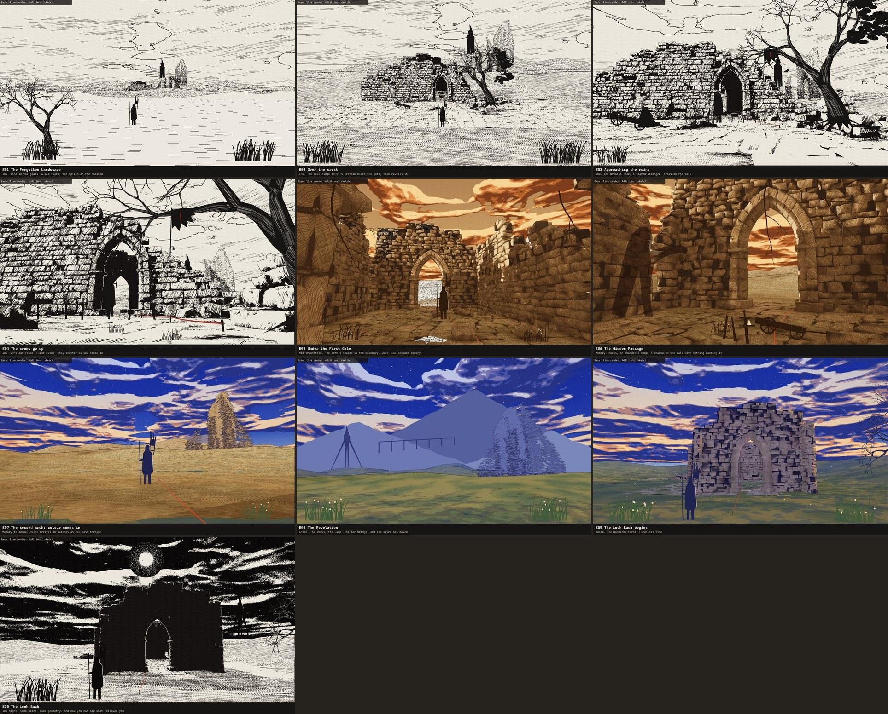

---

## The idea

**You walk into a place where something happened, and slowly realise that you aren't the only one still here.**

The visitor should come away with one unsettling discovery of their own: **the spire on the horizon, visible since the first frame, is not a spire.** Nothing announces it. It stands beside the far ruin from the opening shot. At the Revelation it has taken one step. At the Look Back it is on the other side of you. No text points this out, and a visitor who misses it still gets a beautiful walk.

### The story of this place (fiction, for your approval)

| Then | Now |
|---|---|
| The gate of The Works was held once. A line of people stood at this threshold, and their swords are still in the ground | Their standard still flies, in rags |
| Trade came through here | One carter still comes. The cart broke long ago. Nobody knows who the carter waits for |
| A tree seeded itself in the rubble and has been growing through the wall ever since | It is the oldest living thing here, and crows nest in it |
| Everyone left | **One surveyor has come to reopen the route,** laying a red line as they go |

This is invented world fiction, and says nothing about you or your work. Your verified facts appear only in the chapters themselves.

### What each language now means

Your four languages can do more than change the look. I propose each one means something, because that is what makes a transition feel like the story turning:

| Language | Meaning | What only this language shows |
|---|---|---|
| **Manga ink** | The record. The world as drawn, as it is now | The sword line reads most clearly |
| **Memory** | What this place was | The shadow on the passage wall. It belongs to the past, and nothing casts it |
| **Anime colour** | The world awake | Fireflies, wildflowers, the first sight of the Lamp |
| **Ink night** | What is watching | The Walker to the south. Stars. The moon |

---

## What scouting the real gate found

I walked the proposed route in the live renderer before drawing anything. These findings shaped the plan **[measured]**:

| Finding | Consequence |
|---|---|
| V7's terrain stops at y = −35, with nothing beyond it | "Begins far away" needs a new plain. It is small and cheap, and in ink an unfinished edge can read as "not yet drawn" |
| **The ground rises to a 3.3 m ridge at y = −34** | A gift. Walking over it gives a natural reveal: the gate appears as you crest |
| North of the inner gate is a nearly empty plain | Your Revelation has nothing to reveal yet, so it is the largest new environment work |
| V7's far wall shows as a flat band with a hard edge | Hide it and replace it with far ridges |
| From behind, the inner gate is a clean black shape in ink night | Your Look Back works very well, with almost no new geometry |
| Ground hatching forms moiré patterns at grazing angles, worst in ink night (see E02, E10) | A real flaw in the current shader. To fix before adding anything on the ground |
| Captures match live output exactly: 0 pixels differ across all four languages at V7's first frame | The first proof's captures can be trusted as the comparison baseline |

---

## The walk

**About 156 m** in 11 legs, against the first proof's 23 m **[computed from the waypoints]**.

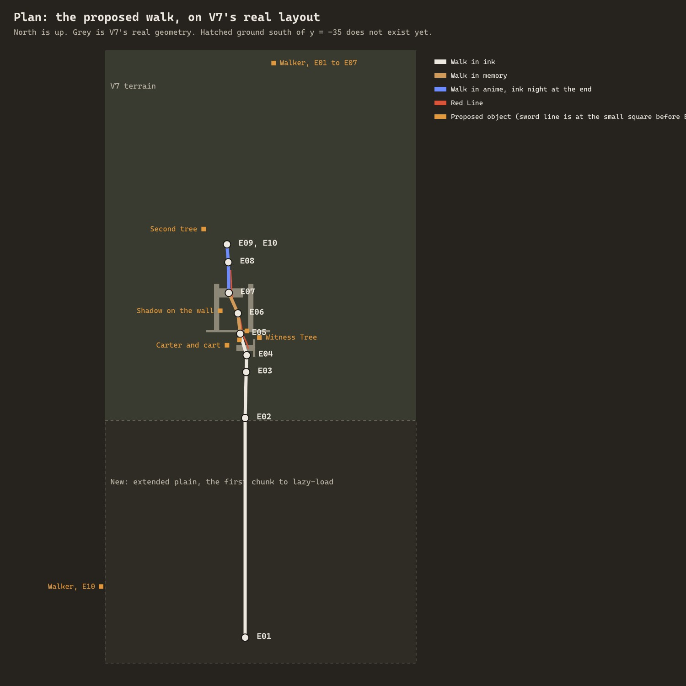

| Moment | Notches | Metres | Language | Camera idea |
|---|---|---|---|---|
| 1 The Forgotten Landscape | 0–24 | 86 | Ink | Long, level, nearly static push. Then you crest the ridge |
| 2 Approaching the Ruins | 24–40 | 25 | Ink | Descends, and sinks to V7's own low angle |
| 3 The First Gate | 40–54 | 9 | Ink → Memory | Slows sharply. Tilts up as the arch passes overhead |
| 4 The Hidden Passage | 54–68 | 13 | Memory | Narrow, slow, with a slight drift towards the left wall |
| 5 The Revelation | 68–84 | 16 | Memory → Anime | Through the inner arch, then opens wide and holds |
| 6 The Look Back | 84–100 | 7 | Anime → Ink night | Barely moves. A slow 180° turn, then a long hold |

**Total: 100 wheel notches, about 33 seconds at 3 notches a second without stopping.** The master storyboard gave this stretch 42. See the first decision below.

**The pacing is deliberately uneven:** 86 m in the first quarter, then only 9 m across the 14 notches of the First Gate. Slowing down is what makes the gate feel like a threshold.

---

## The frames

### Moment 1: The Forgotten Landscape

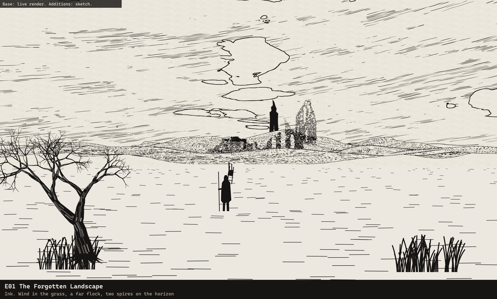

**E01, notches 0–14.** A blank page first: the ink awakening draws this frame stroke by stroke (see [choreography](TRANSITION_CHOREOGRAPHY.md)). Wind moves the grass. A flock crosses far off. The dead tree at left is the first thing with history. A small figure already walks ahead of you, and the gate is tiny. **Two spires stand on the horizon, and nothing draws attention to that.**

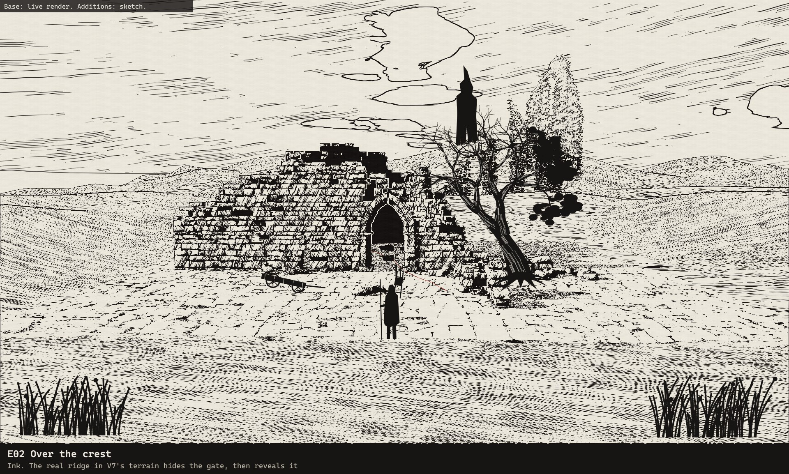

**E02, notches 14–24.** The camera rises over the real ridge, and the gate appears. **The Witness Tree** grows out of the rubble beside it, your landmark for the first half. A short hold.

### Moment 2: Approaching the Ruins

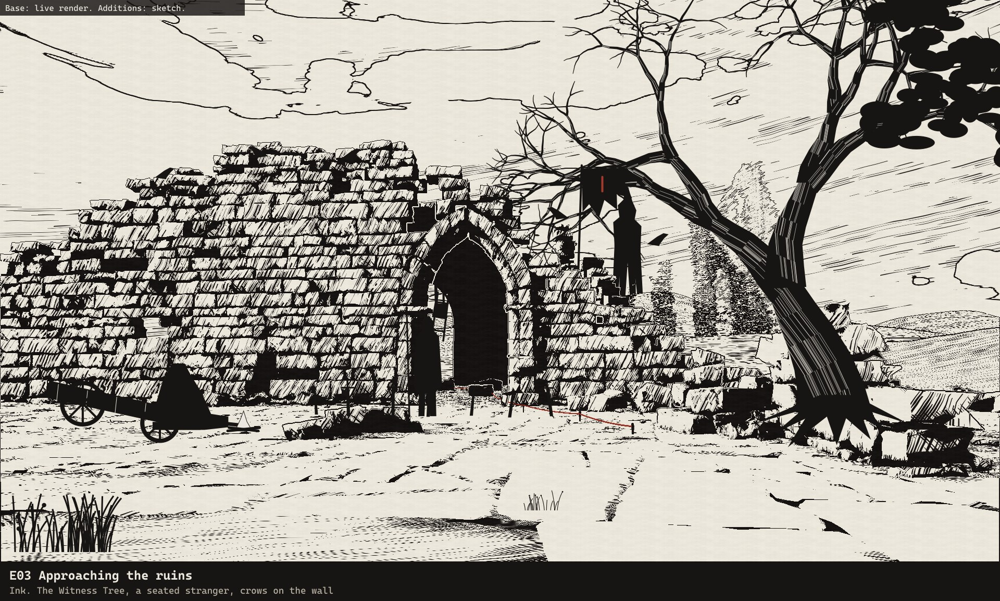

**E03, notches 24–34.** Details arrive progressively: the broken cart and a seated stranger at a small fire on the left, a torn standard on the wall, a line of swords at the threshold, crows along the wall top. The Red Line starts here, and leads to the arch. **The stranger looks up as you pass, and does nothing else.**

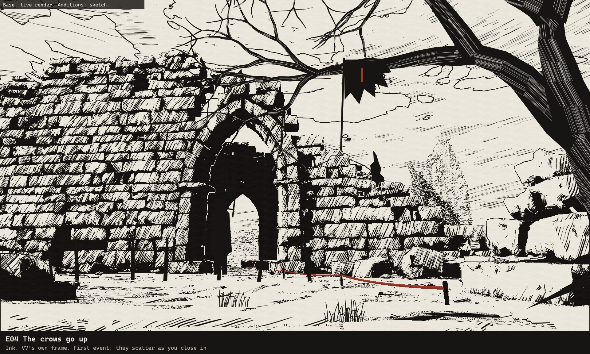

**E04, notches 34–40.** V7's own first frame, kept exactly. **First event: the crows go up.** Not all at once: one, then the rest, wheeling towards the Witness Tree. This is the first time the world reacts to you, so it has to be the best-timed moment in the sequence.

### Moment 3: The First Gate

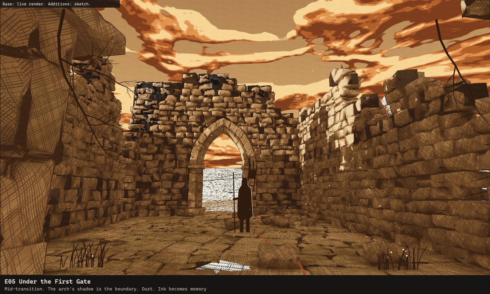

**E05, notches 40–54.** Under the arch, the sound would drop away. **The arch itself is the transition:** its shadow crosses the frame, and on the far side you are in memory. Ink is still visible behind you if you scroll back. Dust is lit for the first time. Roots come over the walls. The Wanderer is framed in the inner arch ahead.

### Moment 4: The Hidden Passage

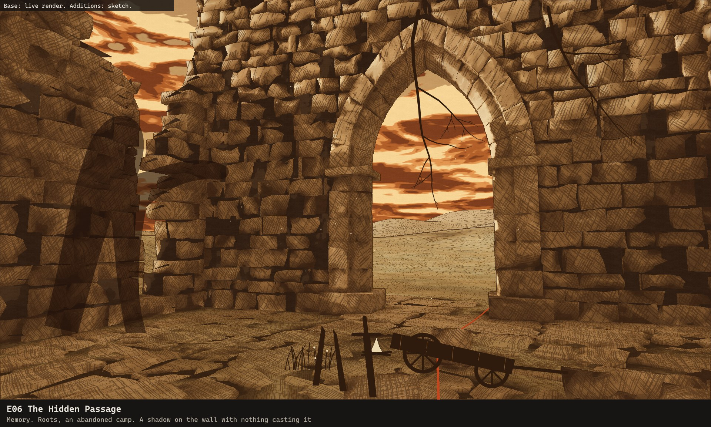

**E06, notches 54–68.** Narrow and quiet. An abandoned camp by the inner arch: a smaller cart, three blades stood upright, a cold fire. Someone tried to go further and didn't.

**Second event: the shadow.** On the left wall, something tall and long-limbed crosses the stone, in the low memory sun. **Nothing is casting it.** You look, and nothing is there. It is drawn into the light itself, so it costs almost nothing, and it exists only in this language.

### Moment 5: The Revelation

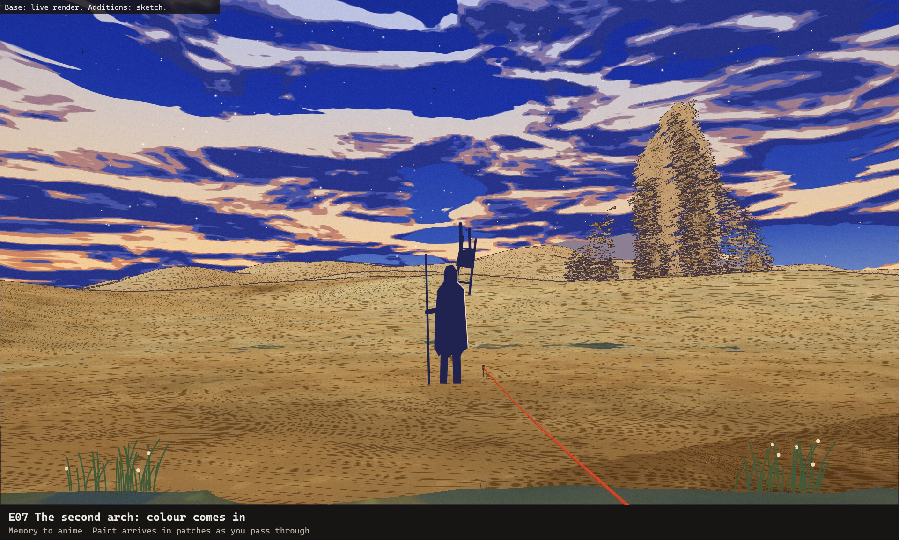

**E07, notches 68–76.** Through the second arch, **colour comes in as patches of paint:** ground last, sky first. The Wanderer has stopped to look.

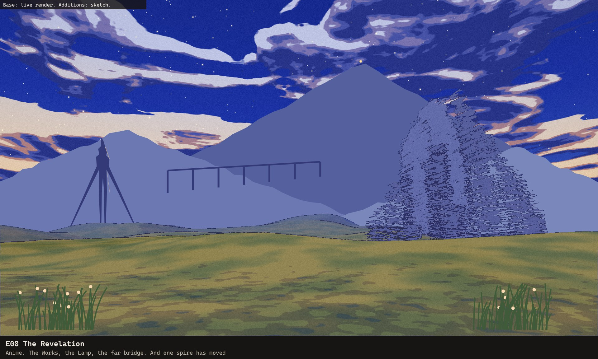

**E08, notches 76–84.** The whole frame opens. **This is the first sight of The Works:** the mountain, the unfinished bridge far off, and one gold point at the summit, the Lamp. It connects this prologue to the rest of the portfolio, and gives the journey a destination.

**Third event, on the left: the "spire" has moved.** Its legs are open now, and it is no longer beside the far ruin. A visitor may notice only that something has changed. A long hold lets the world breathe, with the flock circling.

### Moment 6: The Look Back

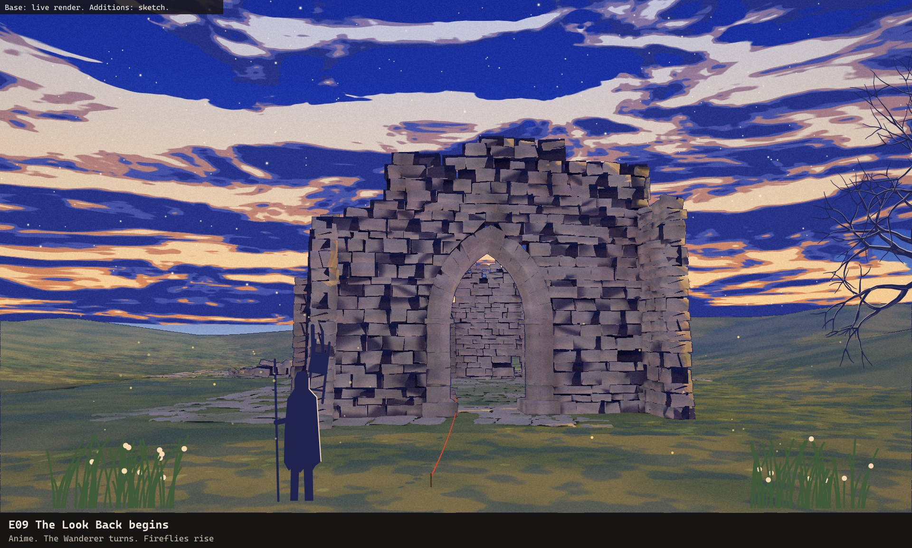

**E09, notches 84–92.** The camera slowly turns around, past the Wanderer, who has turned too. Fireflies lift out of the wildflowers. The gate you came through stands alone, still lit by the last sun.

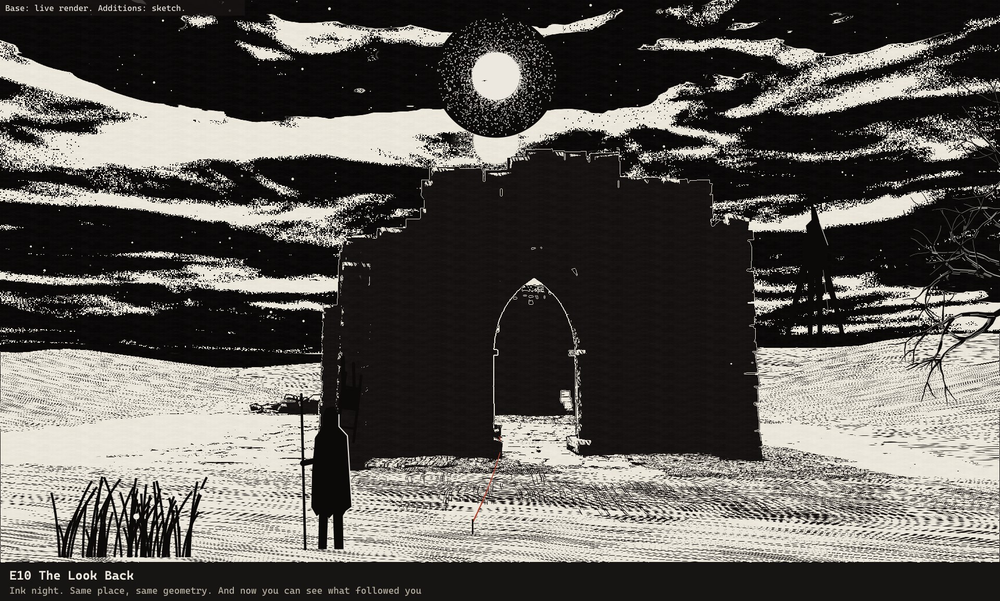

**E10, notches 92–100, then rest.** **The ending.** Colour drains, the sky goes black, fireflies become stars, the moon comes out of the cloud above the gate. The gate is one black shape with a thin white line around the arch. The Wanderer stands in the left third.

**And on the far right, small, past the gate you just walked through, is the Walker. It was never north of you. Or it has been following.** It doesn't move. Don't explain it.

---

## What I changed from your six moments, and why

| Your direction | What I did | Why |
|---|---|---|
| Six moments | Kept all six, in your order | They work |
| "A strange silhouette or creature can briefly appear" | **One creature, the Walker,** plus a shadow that may or may not be it | Restraint. One idea repeated three times is scarier than three monsters |
| Winged creature across the moon | Replaced by one small crow, for now | A second creature would dilute the Walker. Easy to add if you disagree |
| Moment 5 "memorable visual event" | The first sight of the Lamp, and the Walker's step | Connects to the journey and the mystery, not just spectacle |
| The first proof's ending (moon through the inner arch) | Moved to the Look Back | That frame was strong, but yours is stronger, and only one can be the ending |
| Monster showcase, many characters | Two people and one creature in this stretch | The research says tiny figures and huge forms, with long quiet between |

---

## Decisions for you

1. **Length.** This stretch takes 100 notches instead of 42, about 33 seconds non-stop. It is the first thing every visitor sees, before any of your work. **I recommend it,** with the chapter menu letting anyone jump ahead, but it is a real cost for a hurried recruiter.
2. **The Look Back conflict.** The master storyboard says Chapter 6 is "the only time the camera turns to face where it has been", and calls that the moment that justifies a real world. Your Moment 6 uses the same move far earlier in the walk. **I recommend keeping yours, but as a shorter, smaller gesture here,** so Chapter 6 still feels bigger because it shows the whole route. Alternatively, end on the moon through the inner arch and save the turn for Chapter 6.
3. **The Walker.** Does the "spire that isn't" feel right as the one creature here?
4. **The Wanderer.** Your brief says "a lone wandering warrior". I have drawn the original surveyor: a coat, a frame pack and an iron staff, with no sword. A lone armed warrior seen from behind is the single closest thing to the design we must not borrow, so I strongly recommend the surveyor.
5. **Moment 1's blank page.** First load takes 8–17 seconds on a cold browser. I propose turning that wait into the ink drawing itself. Is an opening page with no 3D visible for a few seconds acceptable?

## Assumptions

- All positions are proposals, except V7's camera path and the terrain heights, which are measured.
- The notch counts are a starting point, and only real scrolling can settle them.
- This stretch replaces stops 0a–0d of the master storyboard. The Drafting Room would follow from the Look Back, and that join isn't designed yet.
