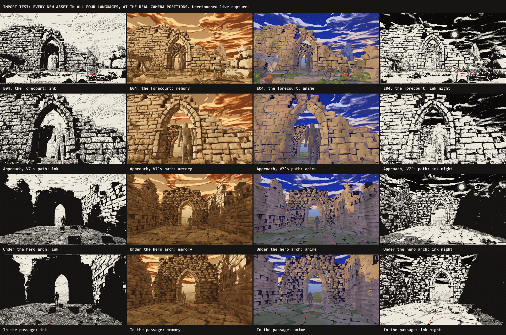
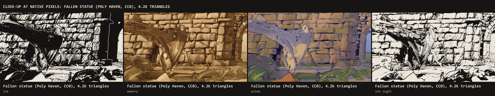
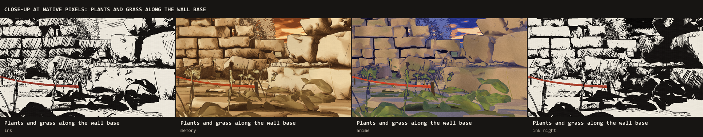
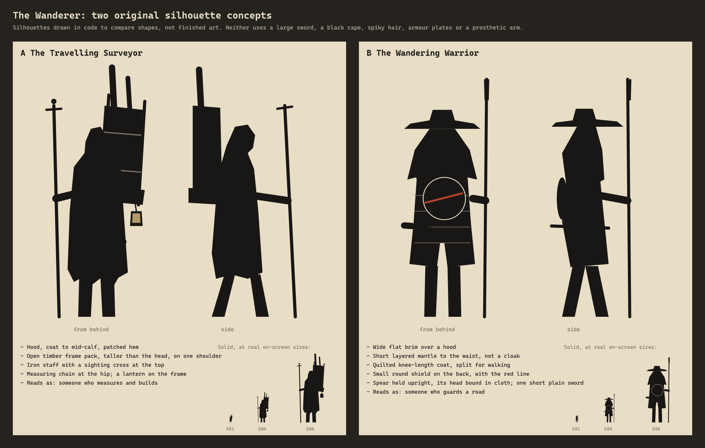
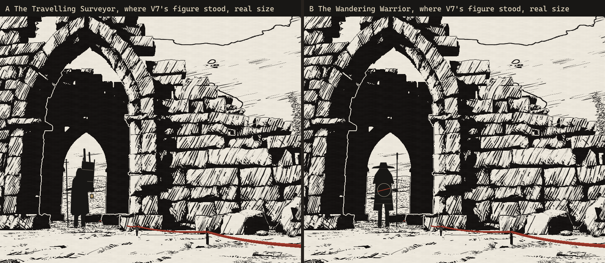

# Import Test Results

**Status: partial. The tree, crow and cart are not tested yet**, because they are on Sketchfab and need your login to download. Everything else you asked for was tested and is reported below with measured numbers. No environment production started, the website, V7 and both earlier gate proofs are unchanged, and nothing is committed.

## What was tested

| Asset | Source, licence | What it tests | Result |
|---|---|---|---|
| **Fallen statue** | Poly Haven, CC0 | A scanned prop through the full pipeline | Works. Needs art tuning |
| **Dry branches**, including one scaled 3× as a fallen bough | Poly Haven, CC0 | Thin branches | **Stable,** as stable as stone |
| **Weeds and dandelions** | Poly Haven, CC0 | Small plants, instancing, wind | Work, but **shimmer, and too heavy** |
| **Grass** | Made in code | Grass shimmer, alpha cards against geometry | Works, but **shimmers** |
| **Walking figure** | Quaternius mannequin and animation library, CC0 | Skinning, playback, foot sync | **Works** |
| Tree, crow, cart | Sketchfab, CC BY | Thin branches on a real tree, bird animation | **Not tested: waiting for downloads** |

Each download was licence-checked on the day, saved with its pages as PDF and recorded with SHA-256 in the [licence register](../../../ASSET_LICENSE_REGISTER.md#in-use-import-test-only). Uncertain-provenance assets stayed excluded.

## Your checklist

| Check | Result | Evidence |
|---|---|---|
| **No regression** | With the new assets switched off, the extended renderer is **pixel-identical** to the first proof: 0 pixels differ in ink and in anime | Side-by-side run of both servers |
| **Custom G-buffer skinning** | **Works.** The renderer's own shader now does skeletal animation, with no help from three.js materials | [Figure close-up](captures/12-close-up-3.png) |
| **Animation playback** | **Works.** 43 clips on one skeleton for bodies and animations, so no retargeting. Five clips exported in 155 KB | |
| **Scroll-synchronised feet** | **Works, with residual slip.** See below | |
| **All four languages at real distances** | **Works** for every new asset | [Board](captures/10-four-languages-at-real-distances.png), [before and after](captures/11-before-and-after.png) |
| **RTX 4050 and Intel** | Measured. See below | `measure/bench-2026-11-06.json`, `load-2026-11-06.json` |
| **Thin branches** | **Stable** | Stability table |
| **Grass shimmer** | **Real problem** | Stability table |
| **Alpha overdraw** | **Not a problem at this density.** Differences were within run-to-run noise | Variant table |
| **Shader compilation** | **First visit got slower:** about 12 s, up from about 7 s | Load table |

## Feet

The walk advances one cycle per stride length, which was measured from the clip in Blender: 1.22 m per cycle. To check that the test really detects sliding, I also ran it with deliberately wrong strides.

| Stride used | Planted-foot slip, as a share of distance walked |
|---|---|
| 0.8× | 34% |
| 0.9× | 23% |
| **1.0×, as measured** | **14%** |
| 1.1× | 11% |
| 1.2× | 17% |
| 1.3× | 23% |

**The sync works: slip is lowest at the measured stride and climbs either side of it.** The remaining 11–14% comes from the clip itself, whose feet don't move at a constant speed. **Getting close to zero needs foot locking (IK on the planted foot),** which is the next step for any close-up walking. At the gate's camera distances, you need to judge whether it reads as sliding.

## Stability in motion

Same measure as for V7 and the first proof: flicker divided by image change, from 24 consecutive frames with the camera moving. **Lower is steadier.** The old stone is the reference.

| Group | Ratio | Verdict |
|---|---|---|
| Stone, reference | 0.54 | V7 offline was 0.46–0.58 |
| **Thin branches** | **0.55** | As steady as stone |
| Figure | 0.58 | Fine |
| Statue | 0.63 | Slightly worse: fine sculpted folds after decimation |
| **Plants** | **0.78** | **Shimmers** |
| **Grass** | **0.83** | **Shimmers** |

**Freezing the wind changed nothing** (0.83 against 0.82), so this is real thin-geometry shimmer, not intended motion. [Wind does move](captures/13-wind.png) the grass and plants.

**Anchoring marks to the rest pose made no measurable difference on the figure at this distance** (0.566 against 0.573). It costs a fifth full-screen float buffer, about 33 MB at 1080p [calculated]. I'd test it close up before keeping it.

## Performance

**Frame time per frame, 1080p, readPixels-forced:**

| View | RTX 4050, before → after | Intel UHD, before → after |
|---|---|---|
| E04 forecourt | 2.2 → 2.6–3.1 ms | 11.6 → 12.7–14.9 ms |
| Approach | → 2.7–3.1 ms | → 13.6–16.4 ms |
| Under the arch | → 2.6–3.1 ms | → 13.9–17.4 ms |
| Passage | → 3.1–3.5 ms | → **16.0–18.8 ms** |

Ranges cover the four languages. **The RTX 4050 is untroubled. Intel no longer holds 60 fps in the passage,** which confirms that integrated graphics need the reduced mode and a lighter gate.

**What each group costs on Intel** (geometry pass, forecourt; noise between runs is about ±0.5 ms):

| Variant | Triangles drawn | Geometry pass |
|---|---|---|
| Assets off | 330k | 6.2 ms |
| All on | 495k | 7.1 ms |
| Without grass | 475k | 6.9 ms |
| Without plants | 390k | 6.8 ms |
| Grass as alpha cards | 477k | 7.6 ms |
| Grass ×4, blades | 555k | 7.1 ms |
| Grass ×4, alpha cards | 483k | 7.1 ms |

**The plants are 105k triangles, ten times their 10k budget,** because I kept 600–900 triangles per plant. That is my mistake to correct, not a property of the assets.

**Loading:**

| | Before | After |
|---|---|---|
| First visit, shaders not cached | About 7 s | **About 12 s** |
| Second visit | 0.4 s | 0.7 s |
| Asset loading itself | | 0.3 s |
| Download added | | 0.54 MB: statue and branches 191 KB, plants 197 KB, figure 155 KB |

The first-visit increase is shader compilation: five new geometry variants, and a larger shading program for the new materials. **I first had a 3.8 s ground-height lookup; I fixed it in this test** (0.25 s now) by testing only the floor's upward-facing triangles.

## What looks right, and what doesn't

| | Verdict |
|---|---|
| Skinned figure | Hatching follows the body, clean outline, convincing in all four looks. A placeholder body |
| Fallen statue | Reads as a toppled figure. **In ink, its decimated folds turn into a noisy black tangle; in anime it is too pale and violet** |
| Plants | **The weakest.** In ink they are lumpy black masses; they are too big and too dense |
| Grass | Reads as strokes in ink, but shimmers |
| Branches | Hold up well |

## Recommended fixes before the expanded prototype

1. **Plants:** about 120 triangles each, half as many, smaller, and drawn with outline and a few strokes in ink instead of a solid mass.
2. **Grass:** widen blades to at least about 1.5 px on screen in the vertex shader, thin them out with distance, and prefer fewer, bolder tufts.
3. **Foot locking** for the Wanderer's planted foot.
4. **Rest-pose anchoring:** test close up, and drop it or pack it smaller if it still shows no benefit.
5. **Shader compilation:** merge G-buffer variants and compile the rest in the background.
6. **Statue:** keep more triangles where folds are fine, and warm its anime colour.

## Not done, and why

- **Tree, crow and cart:** need your Sketchfab downloads (the five links I sent). The same pipeline and tests will run on them unchanged.
- **Mixamo:** not used, as you asked.
- **Free-tier bodies:** the free Quaternius download only includes the **superhero proportions**, not the regular ones listed for the paid source kit. Under a coat this matters less, and bone scaling can narrow the shoulders. The test used the library's neutral mannequin.

## The Wanderer: two silhouette concepts

As you asked, neither is final.

| | A. Travelling Surveyor | B. Wandering Warrior |
|---|---|---|
| Key shapes | Hood; tall canvas pack on a frame over one shoulder; iron staff with a sighting cross | Wide flat brim over a hood; short layered mantle; small round shield; spear with its head bound in cloth |
| Reads as | Someone who measures and builds | Someone who guards a road |
| Distance from the source character | No sword at all | One short, plain sword; the spear is carried, never brandished |
| Fits the portfolio's story | Directly: an engineer, laying the Red Line | Through the road being guarded |

**Composition finding:** a dark figure standing in front of the arch's black interior disappears in ink. Both concepts read when placed against light, as above, so the Wanderer's staging must keep light behind it.

Both are checked against the list of features we must not borrow: no large sword, no black cape as the main shape, no spiky hair, no prosthetic arm, no plate armour, no wolf-like helm.

## Files

| Path | Holds |
|---|---|
| `import-test/` | The extended renderer (a copy of the baseline). Run with `PORT=4176 node planning/reset/gate-proof-v2/import-test/serve.mjs` |
| `import-test/assets/` | The four compressed GLBs actually loaded |
| `import-test/captures/` | Comparison boards from live captures |
| `import-test/measure/` | Benchmark and analysis scripts, and raw results |
| `wanderer-concepts/` | The two silhouette boards and their drawing code |
| `~/portfolio-assets/` | Read-only sources with licence PDFs and checksums, Blender scripts, raw exports. Outside the repository |
